keyestudio Ultimate Starter Kit for Raspberry Pi

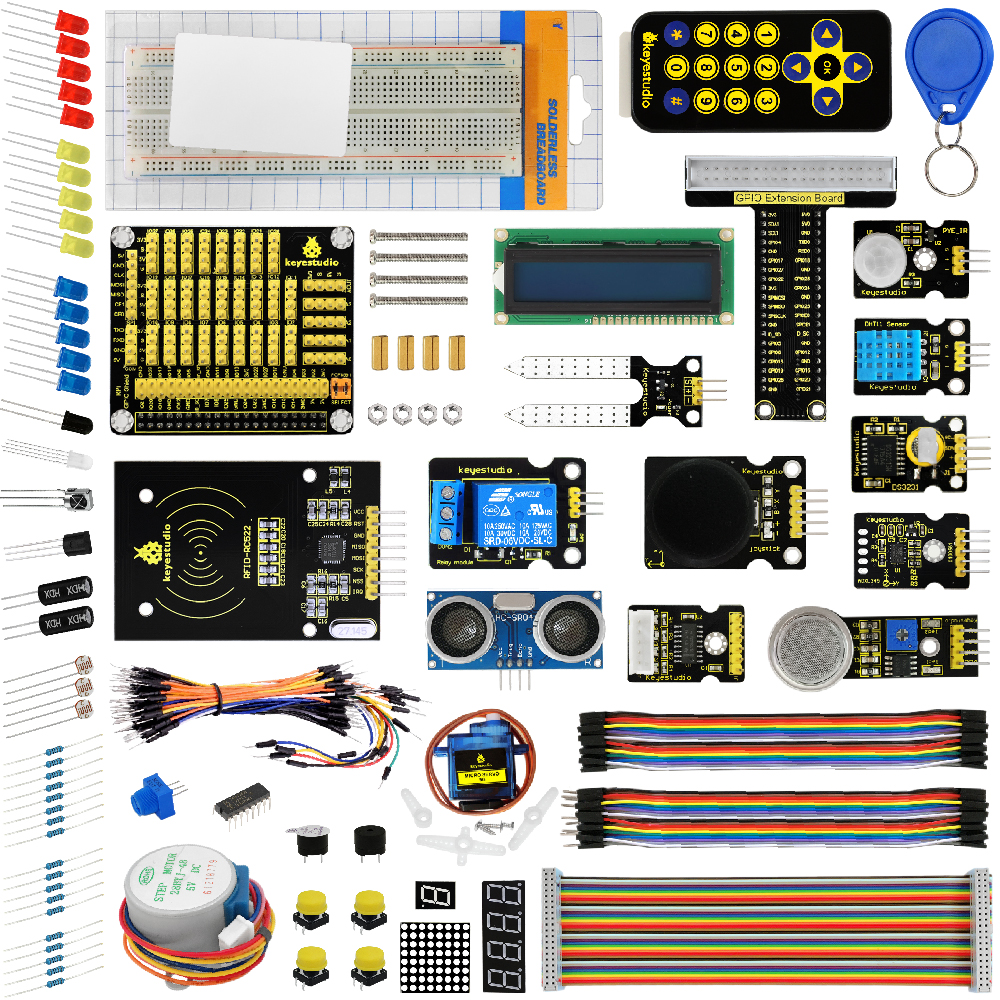

# 1、Product Description

Raspberry Pi is a delicate card computer. This is a starter kit of Raspberry Pi, very suitable for zero-based raspberry pi enthusiasts. Through this kit, you can learn more about the knowledge of linux operating system, as well as C, python and other language programming based on the debian system of Raspberry Pi. This kit also provides you with some related sensors and modules applied to the Raspberry Pi .

We offer richer learning materials that allow you to learn about Raspberry Pi from scratch. The learning materials include the installation and usage of the Raspberry Pi related system, where also offer you the learning courses of Raspberry Pi collocated with some commonly used sensors and modules. It would be better If you are an arduino hobbyist because arduino and Raspberry Pi are the best partners. You can make more creative DIY works via arduino strong community support and rich third-party library resources, integrating into Raspberry Pi's powerful function support to motivate your creativity and inspiration!

# 2、Kit List

|No.|Product Name|Quantity|Picture|
|---|------------|--------|-------|
|1|Keyestudio RPI GPIO-PCF8591 Shield|1|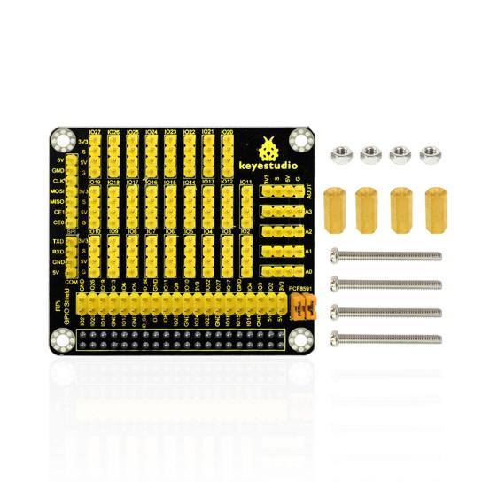|
|2|LED - Blue|5||
|3|LED - Red|5||
|4|LED - Yellow|5|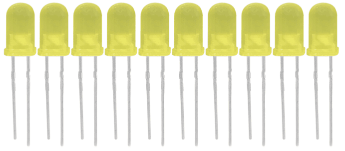|
|5|LED - RGB|1|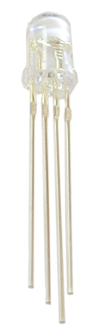|
|6|220Ω Resistor|8|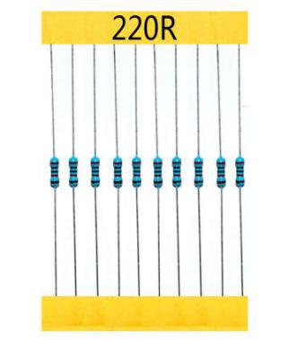|
|7|10KΩ Resistor|5|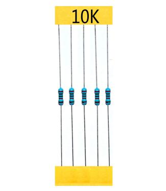|
|8|1KΩ resistor|5|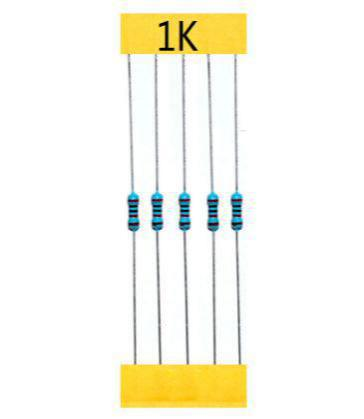|
|9|10KΩ Potentiometer|1|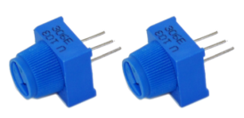|
|10|Buzzer (active)|1||
|11|Buzzer (passive)|1||
|12|Large Button Switch|4||
|13|Ball Tilt Sensor|2|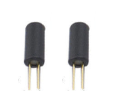|
|14|Photo Resistor|3|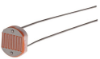|
|15|Flame Sensor|1||
|16|LM35 Temp Sensor|1|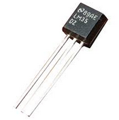|
|17|IC 74HC595N 16-pin DIP|1|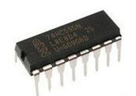|
|18|1-digit LED|1|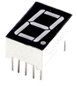|
|19|4-digit LED|1|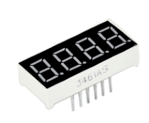|
|20|8*8 LED Matrix|1|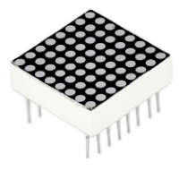|
|21|2x16 LCD display|1|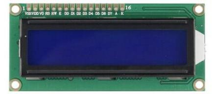|
|22|IR Receiver|1|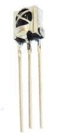|
|23|IR Remote Control|1|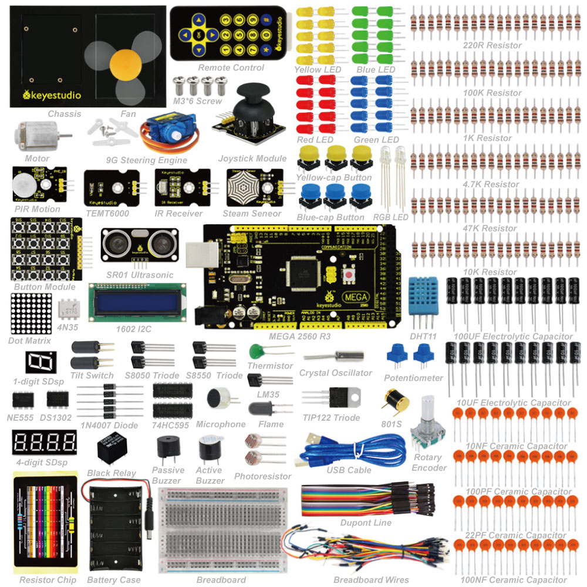|
|24|Servo Motor|1||
|25|Stepper Driver|1|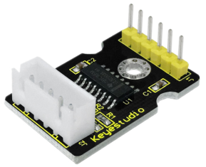|
|26|Stepper Motor|1||
|27|Joystick Module|1|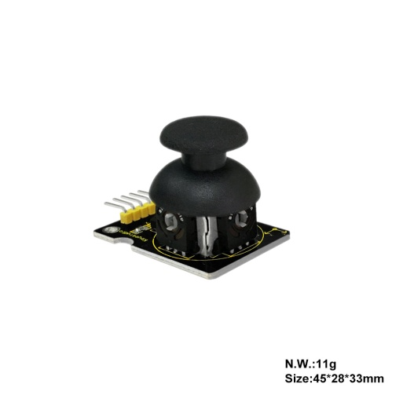|
|28|Relay Module|1|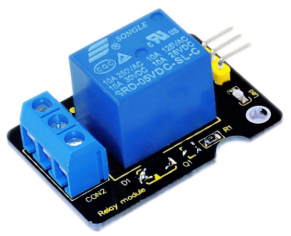|
|29|PIR Motion Sensor|1|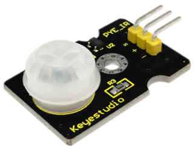|
|30|Analog Gas Sensor|1|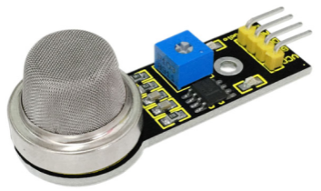|
|31|ADXL345 Three Axis Acceleration Module|1|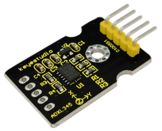|
|32|HC-SR04 Ultrasonic Sensor|1|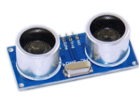|
|33|DS3231 Clock Module|1|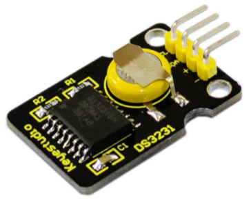|
|34|DHT11 Temperature and Humidity Sensor|1|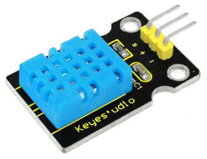|
|35|Soil Humidity sensor|1|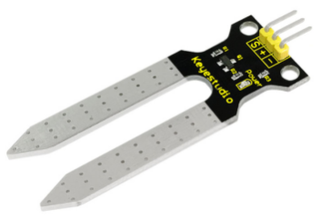|
|36|RC522 RFID Module|1|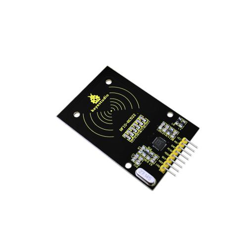|
|37|RFID Card|1||
|38|Access Key|1||
|39|RPI GPIO Shield|1|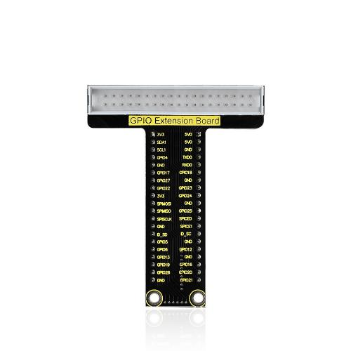|
|40|830-hole Breadboard|1|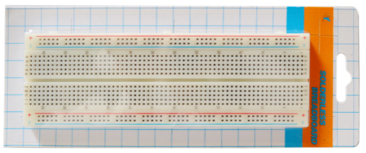|
|41|Female to Female Dupont Wires|20|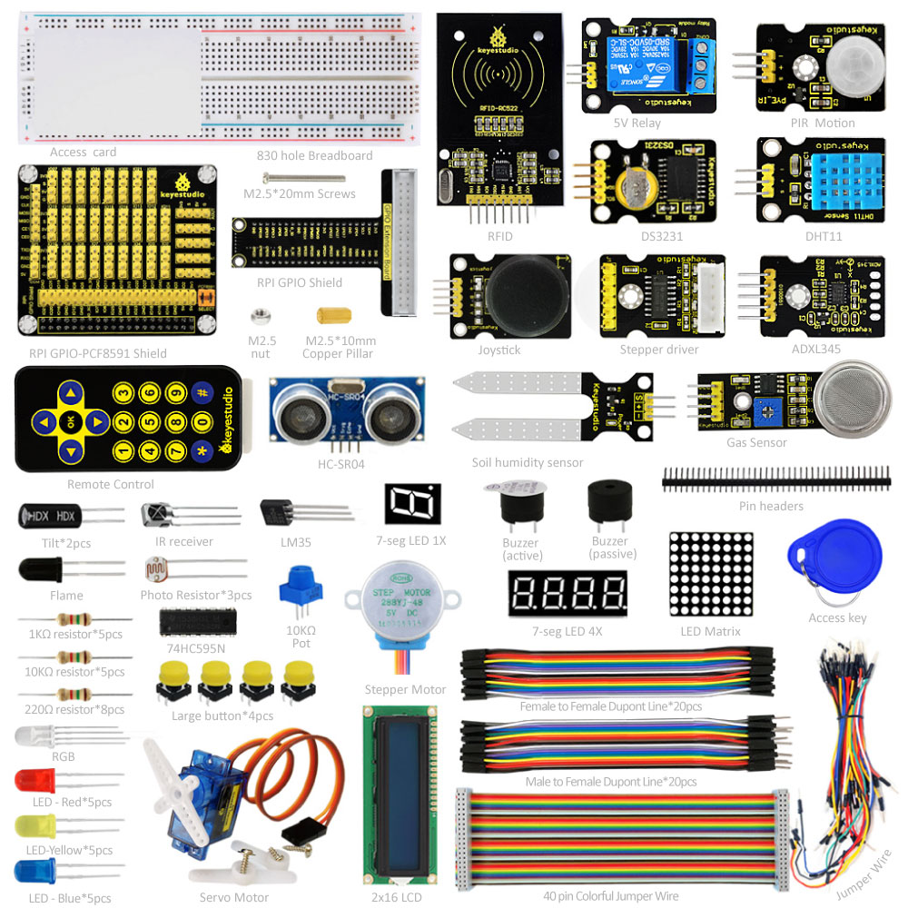|
|42|Male to Female Dupont Wires|20||
|43|Jumper Wires|30|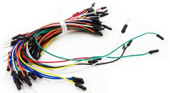|
|44|40 pin Colorful Jumper Wires|1||

# 3、System Programming & Corresponding Tool Library Installation

1. Format the TFT card:

a. Plug the TFT card into the USB port through the card reader, open and install the SDFormatter tool in tool folders we provided. Open the tool as the figure shown below:

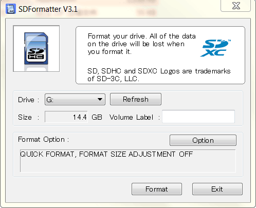

Tool Website: <https://www.sdcard.org/downloads/formatter_4/index.html>

b. The Driver in the upper figure: G is the TFT card just inserted. If you have several other TFT cards inserted in the computer, you can pass the drop-down menu to select the TFT card that needs to be formatted. And then click "Format", it will automatically format the TFT card. The formatting process will pop up the warning as shown below, then click OK.

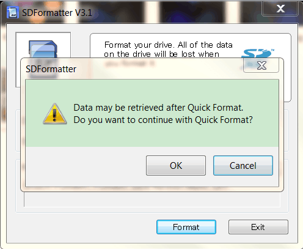

c. The picture below shows the successful format of the TFT card:

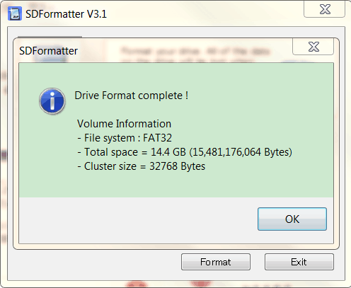

2.  Program Raspberry Mirror Image:

a. Open the Win32DiskImager in tool folder we provided, open the     tool as the following figure shown:

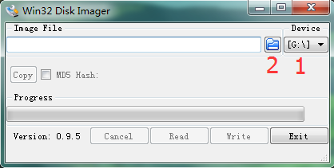

b. Click marked 1 to select the formatted TFT card, then click     marked 2 to choose the system image file     "2017-01-11-raspbian-jessie-lite" in the raspberry image folder we     provided. The figure shown as below:

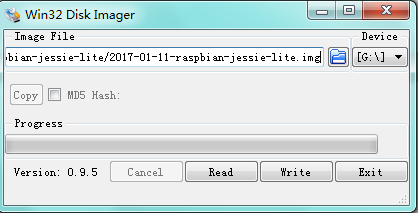

Raspberry Pi Download     Address：<https://www.raspberrypi.org/downloads/>

c. The above steps are configured well and click “Write”, it     will automatically program the raspberry mirror image to the TFT     card, and you need to wait for a few minutes in this process. Below     shows the Write Successful. Then click “OK “ to unplug the TFT card.

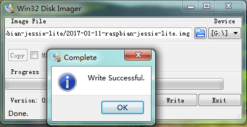

# 4、Log into Raspberry

1. Log into Raspberry via SSH

1.  Insert TFT card burning well the system into Raspberry board.     Internet interface of the motherboard is connected to LAN via the     network cable, and the mini USB port on the motherboard is powered     by an external power supply.

Then, use Advanced IP Scanner software，click     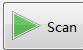，find     the corresponding IP address of the raspberry pi, as shown below:

When logging in by SSH, you first need to put an ssh file in the     system root directory, as shown below:

b. Open the PUTTY tool in the folder tool, only set two     places of red circle as the figure shown below, the other places not     to be set, and then click "Open" to log in.

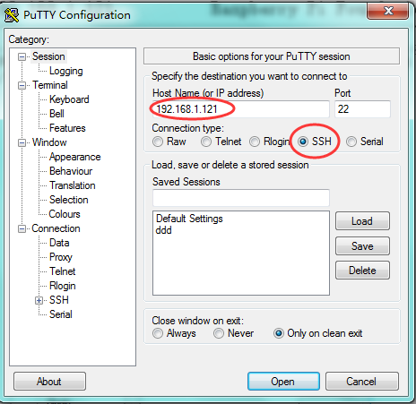

Username for the initial login in Raspberry system: pi

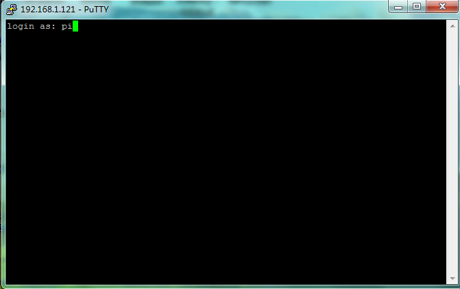

Password: raspberry

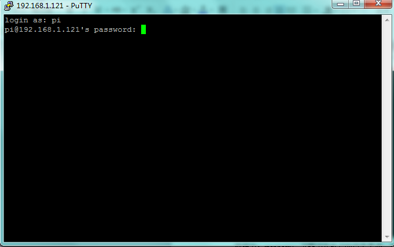

Logging in Raspberry system for the first time, it is better to     expand the root partition to the entire TFT card, then on the     terminal please input: sudo raspi-config

It will appear the following window after execution:

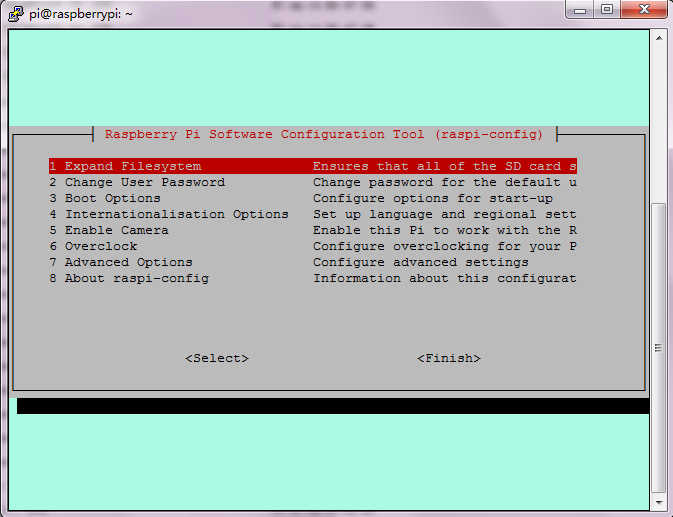

Then, select 1 Expand Filesystem through the keyboard’s "↑↓"key, and     click “Enter” key on the keyboard. Then through the "→ ←"key to     select “Finish”, and click the “Enter” key on the keyboard. Finally,     pop up the following window, then click “Yes”.

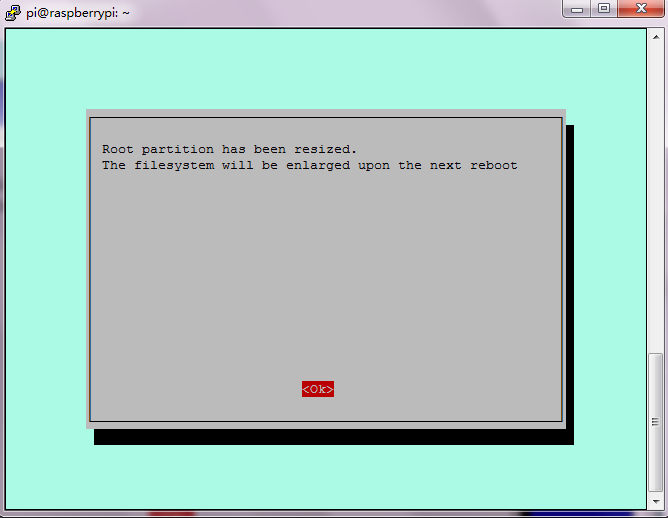

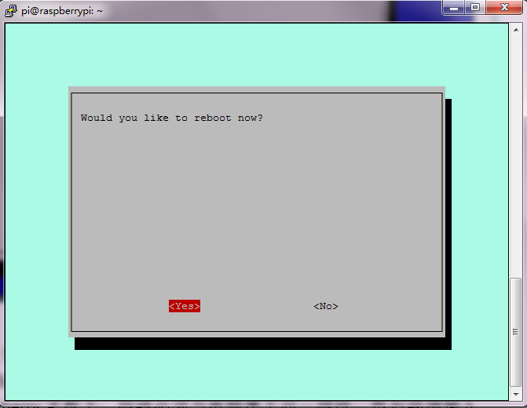

After click Yes, it has rebooted the Raspberry, so you just need to     re-login it.

2.  Using WinSCP to transfer file between PC host and Raspberry

1.  Plug the network cable of the router into the Raspberry motherboard,     and network cable must belong to the same network segment with the     computer. Then input ifconfig command in the terminal to check     the Raspberry’s IP, and the IP at this moment is 192.168.1.121 as     shown in the following figure:

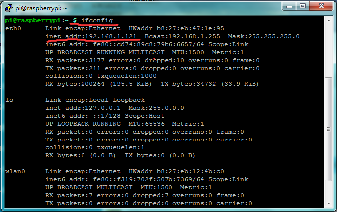

2.  Open the folder tool where provides a WinSCP installation     package, then install and open the application program, the window     interface shown as the figure below:

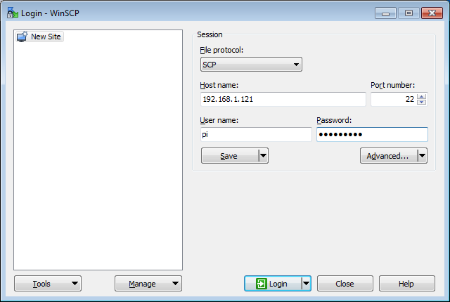

3.  File protocol is SCP; Host name is Raspberry’s IP     address; Default port number is 22; Username is     pi; Password is raspberry. Then click “Login”, if the     login process appears prompts, click “Yes”. Appearing the below     figure means successfully log in WinSCP.

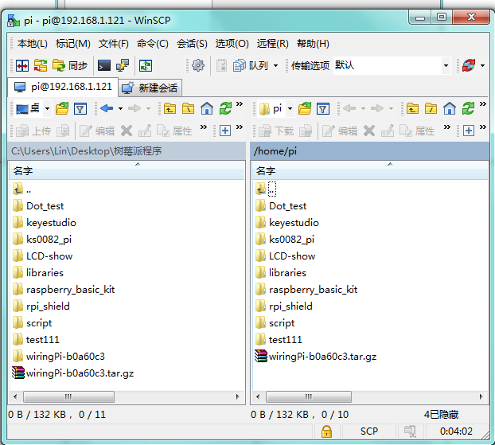

3. Install Wiringpi

1.  Wiringpi is a library file for raspberry to control IO port, in     which integrates I2C library, SPI library, UART library, software     PWM library and more. The relevant library function folder provides     the compression package of wiringpi library file. Or you can     download it on the official website:
<https://projects.drogon.net/raspberry-pi/wiringpi/download-and-install/>

Use winSCP to put the wiringPi-b0a60c3.tar of PC into the pi     user folder of raspberry system, as shown in the figure below:

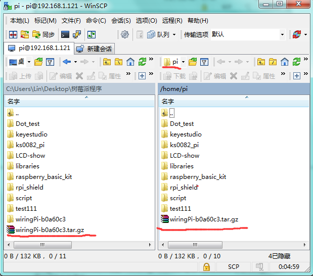

2.  In the terminal input cd/home/pi to enter pi folder; execute     tar-xzf wiringPi-b0a60c3.tar.gz to unzip the file, getting     wiringPi-b0a60c3 folder; in the terminal input cd     wiringPi-b0a60c3 command, execute ./build to install wiringpi.     The window interface below shows the successful installation:

3.  To see whether the wiringpi installation is successful, in the     terminal execute gpio readall command. Pop up the below window     interface means installation successfully.

# 5、Download

[Resource](https://www.dropbox.com/scl/fo/lqidnpu4oc90y98keltf7/ANkHlxWHeUFsJH8HMPWhY_Y?rlkey=obmfprzx7slvq6sugurv8978a&dl=0)

