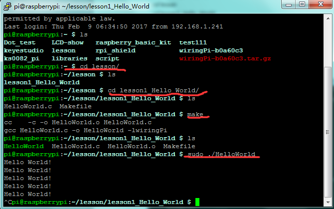

## Lesson 1: Hello World

1.  Introduction

Since it is the first contact with Raspberry Pi, you just need a     raspberry motherboard without other auxiliary components to display     "Hello World!"

2.  Hardware Required

   USB Cable \* 1

   Raspberry Motherboard \* 1

3.  Programming

1.  In the terminal input cd / home / pi and mkdir lesson to     build lesson folder.

2.  Use winSCP to put Lesson1_Hello_world into the lesson folder of     raspberry system.

3.  In the terminal execute cd lesson and cd lesson1_Hello_World
to enter the folder.

4.  In the terminal execute make, generating a HelloWorld executable     file in the folder.

5.  In the terminal execute sudo. / HelloWorld to run the file, the     terminal will print Hello World! as the figure shown below.

6.  Ctrl + c exits the processing program.




4.  Sample Code

```c
#include <wiringPi.h>
#include <stdio.h>

int main()

{
  wiringPiSetup();
//      printf("Hello World!\n");

 for(;;)
 {
 printf("Hello World!\n");
  delay(1000);

 } 
  }

```

5.  Special Instruction

lesson1_Hello_World folder has a Makefile file. Code as below:

HelloWorld:HelloWorld.o

gcc HelloWorld.c -o HelloWorld -lwiringPi

Makefile rule：

Target（target）： Prerequisite（prerequiries）...

\<tab\> Command（command）

Target is usually the name of the file to be generated; Prerequiries is the material to generate the target; \<tab\> Command is a command to execute a target.

When executing the make command in the folder, the system's compiler will generate the executable HelloWorld file according to the instructions in the Makefile file.

More Makefile knowledge please refer to the relevant information.

