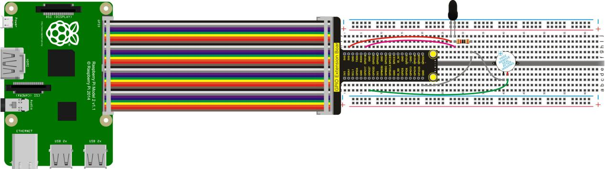
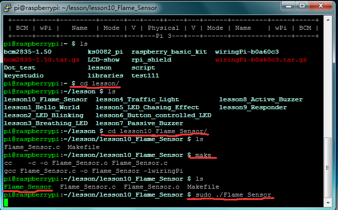

## Lesson 10: Flame Sensor

1.  Introduction

We have done a button controlled light in experiment 6, so this time     we do a flame alarm test using flame sensor. The flame sensor is     specially used for robots to search the fire source, which is very     sensitive to flame. This flame sensor makes use of the high     sensibility of infrared towards flame, using special IR receiver to     detect the flame and then converting the brightness of flame into     high or low level signal. In the experiment, we input the high or     low level signal converted by the brightness of flame to the control     board of raspberry pi, and then to control the buzzer’s ring.

2.  Hardware Required

Active Buzzer \*1

Flame Sensor \*1

10KΩ Resistor\*1

RPI GPIO Shield\*1

40 Pin Colorful Jumper Wires\*1

Breadboard\*1

USB Cable\*1

Raspberry Motherboard\*1

Jumper Wire\*Several

3.  Connection Diagram

4.  Programming

1.  Use winSCP to put the lesson10_Flame_Sensor into the lesson     folder of raspberry system.

2.  In the terminal input cd lesson10_Flame_Sensor to enter the     folder.

3.  In the terminal execute make to generate a Flame_Sensor
executable file inside the folder.

4.  Wiring as the above diagram, then enter the lesson10_Flame_Sensor     folder, execute sudo ./Flame_Sensor at the terminal. It can     achieve the effect of flame alarm.

5.  Ctrl + c can exit the processing program.

5.  Sample Code

////////////////////////////////////////////////////////////////////////////////////////////////////////////////////////

\#include \<wiringPi.h\>

int main()

{

wiringPiSetup();

char val;

{

pinMode(1,INPUT);

pinMode(2,OUTPUT);

}

while(1)

{

val=digitalRead(1);

if(val==1)

digitalWrite(2,LOW);

else

digitalWrite(2,HIGH);

}

}

////////////////////////////////////////////////////////////////////////////////////////////////////////////////////////

