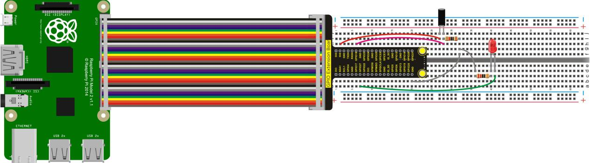
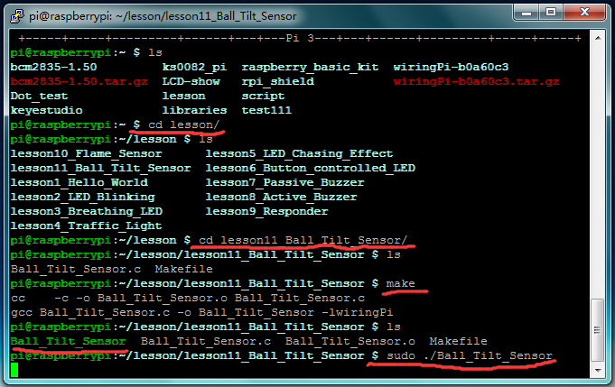

## Lesson 11: Ball Tilt Sensor

1.  Introduction

Ball tilt sensor uses the same theory as tilt switch, in which has a     little metal ball. When it keeps upright, the metal ball touches two     ends of power supply wire; while placed upside down, it is     disconnected, so that the upright and inverted placement produce     different signals. We use button to control LED status in experiment     6, but this time we use the ball tilt switch to control the LED’s on     and off.

2.  Hardware Required

LED - Red \*1

220Ω Resistor\*1

Ball Tilt Sensor\*1

10KΩ Resistor\*1

RPI GPIO Shield\*1

40 Pin Colorful Jumper Wires\*1

Breadboard\*1

USB Cable\*1

Raspberry Motherboard\*1

Jumper Wire\*Several

3.  Connection Diagram

4.  Programming

1.  Use winSCP to put the lesson11_Ball_Tilt_Sensor into the lesson     folder of raspberry system.

2.  In the terminal input cd lesson11_Ball_Tilt_Sensor to enter the     folder.

3.  In the terminal execute make to generate a Ball_Tilt_Sensor
executable file inside the folder.

4.  Wiring as the above diagram, then enter the     lesson11_Ball_Tilt_Sensor folder, execute sudo     ./Ball_Tilt_Sensor at the terminal. It can achieve the effect of     ball tilt switch controlled LED.

5.  Ctrl + c can exit the processing program.

5.  Sample Code

////////////////////////////////////////////////////////////////////////////////////////////////////////////////////////

\#include \<wiringPi.h\>

int main()

{

wiringPiSetup();

char val;

{

pinMode(1,INPUT);

pinMode(2,OUTPUT);

}

while(1)

{

val=digitalRead(1);

if(val==1)

digitalWrite(2,LOW);

else

digitalWrite(2,HIGH);

}

}

/////////////////////////////////////////////////////////////////////////////////////////////////////////////////////////

