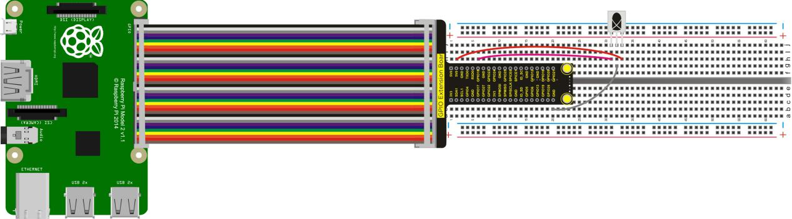
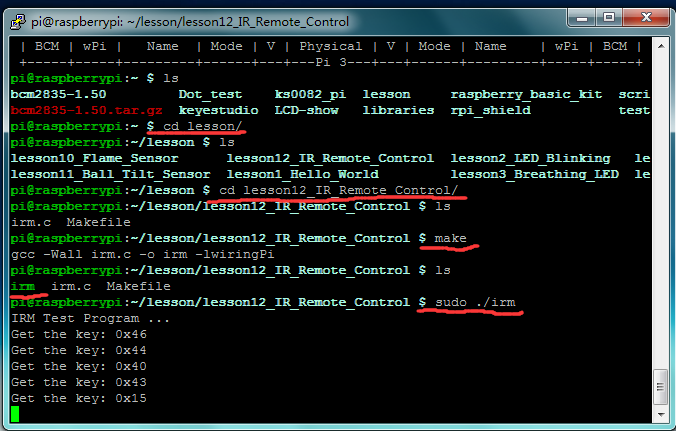

## Lesson 12: IR Remote Control

1.  Introduction

The general IR remote control system is divided into two parts:
transmitter and receiver. In this experiment, the transmitting part     is remote control and the receiving part is IR receiver VS1838B. IR     receiver VS1838B is a component integrated with receiving,     amplification and demodulation, where its internal IC has been     demodulated, and outputs the digital signal. In this experiment,     when the program is compiled and executed, press down the button of     remote control, the terminal will display the value of button.

2.  Hardware Required

IR Receiver \*1

IR Remote Control\*1

RPI GPIO Shield\*1

40 Pin Colorful Jumper Wires\*1

Breadboard\*1

USB Cable\*1

Raspberry Motherboard\*1

Jumper Wire\*Several

3.  Connection Diagram

4.  Programming

1.  Use winSCP to put the lesson12_IR_Remote_Control into the lesson     folder of raspberry system.

2.  In the terminal input cd lesson12_IR_Remote_Control to enter the     folder.

3.  In the terminal execute make to generate an irm executable     file inside the folder.

4.  Wiring as the above diagram, then enter the     lesson12_IR_Remote_Control folder, execute sudo ./irm at the     terminal. When we press down the button of remote control assigned     with the IR receiver module, the terminal will display the value of     button.

5.  Ctrl + c can exit the processing program.

5.  Sample Code

////////////////////////////////////////////////////////////////////////////////////////////////////////////////////////

\#include \<wiringPi.h\>

\#include \<stdio.h\>

\#define PIN 1

\#define IO digitalRead(PIN)

unsigned char i,idx,cnt;

unsigned char count;

unsigned char data\[4\];

int main()

{

if (wiringPiSetup() \< 0)return 1;

pinMode(PIN, INPUT);

pullUpDnControl(PIN, PUD_UP);

printf("IRM Test Program ... \n");

while (1)

{

if(IO == 0)

{

count = 0;

while(IO == 0 && count++ \< 200) //9ms

delayMicroseconds(60);

count = 0;

while(IO == 1 && count++ \< 80) //4.5ms

delayMicroseconds(60);

idx = 0;

cnt = 0;

data\[0\]=0;

data\[1\]=0;

data\[2\]=0;

data\[3\]=0;

for(i =0;i\<32;i++)

{

count = 0;

while(IO == 0 && count++ \< 15) //0.56ms

delayMicroseconds(60);

count = 0;

while(IO == 1 && count++ \< 40) //0: 0.56ms; 1: 1.69ms

delayMicroseconds(60);

if (count \> 25)data\[idx\] |= (1\<\<cnt);

if(cnt == 7)

{

cnt = 0;

idx++;

}

else cnt++;

}

if(data\[0\]+data\[1\] == 0xFF && data\[2\]+data\[3\]==0xFF) //check

printf("Get the key: 0x%02x\n",data\[2\]);

}

}

}

////////////////////////////////////////////////////////////////////////////////////////////////////////////////////////

