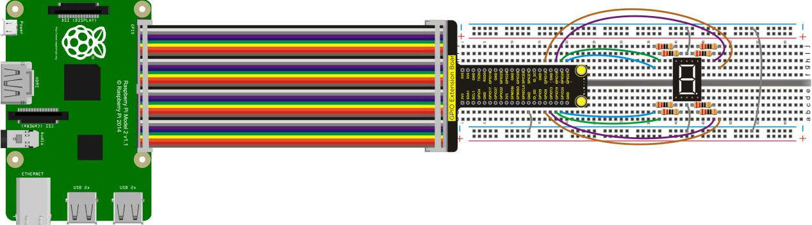
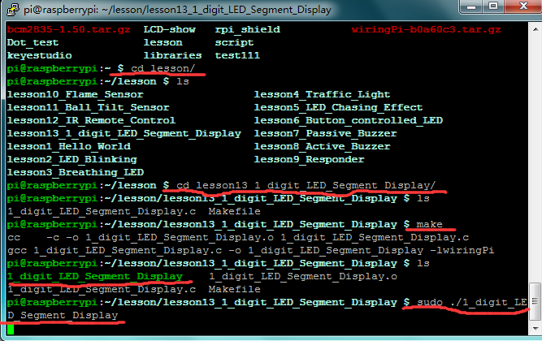

## Lesson 13: 1-digit LED Segment Display

1.  Introduction

LED segment display is a kind of semiconductor light emitting device     whose basic unit is a light emitting diode. LED segment display is     divided into 7-seg display and 8-seg display according to the number     of segment. Compared to 7-seg display, 8-seg display has more than     one light-emitting diode unit (more than a decimal point display).     In this experiment, we will use 8-seg LED display. There are seven     segments of LED display to display the number, and the balance     segment shows the decimal point. As long as the corresponding     segment is lighted up, the segment LED display will show its number.     So in this experiment, we will make 1-digit LED display show several     numbers.

2.  Hardware Required

1-digit LED\*1

220Ω Resistor\*8

RPI GPIO Shield\*1

40 Pin Colorful Jumper Wires\*1

Breadboard\*1

USB Cable\*1

Raspberry Motherboard\*1

Jumper Wire\*Several

3.  Connection Diagram

4.  Programming

1.  Use winSCP to put the lesson13_1_digit_LED_Segment_Display into     the lesson folder of raspberry system.

2.  In the terminal input cd lesson13_1_digit_LED_Segment_Display to     enter the folder.

3.  In the terminal execute make to generate a     1_digit_LED_Segment_Display executable file inside the folder.

4.  Wiring as the above diagram, then enter the     lesson13_1_digit_LED_Segment_Display folder, execute sudo     ./1_digit_LED_Segment_Display at the terminal, 1-digit LED segment     display will successively show the number from 0 to 9.

5.  Ctrl + c can exit the processing program.

5.  Sample Code

////////////////////////////////////////////////////////////////////////////////////////////////////////////////////////

\#include \<wiringPi.h\>

int a=27;//GPIO16

int b=26;//GPIO12

int c=23;//GPIO13

int int e=25;//GPIO26

int f=28;// GPIO20

int g=29;//GPIO21

int dp=22;//GPIO6

int i;

void digital_0()//0

{

digitalWrite(a,HIGH);

digitalWrite(b,HIGH);

digitalWrite(c,HIGH);

digitalWrite(d,HIGH);

digitalWrite(e,HIGH);

digitalWrite(f,HIGH);

digitalWrite(g,LOW);

digitalWrite(dp,LOW);

}

void digital_1()//1

{

digitalWrite(a,LOW);

digitalWrite(b,HIGH);

digitalWrite(c,HIGH);

digitalWrite(d,LOW);

digitalWrite(e,LOW);

digitalWrite(f,LOW);

digitalWrite(g,LOW);

digitalWrite(dp,LOW);

}

void digital_2()//2

{

digitalWrite(a,HIGH);

digitalWrite(b,HIGH);

digitalWrite(c,LOW);

digitalWrite(d,HIGH);

digitalWrite(e,HIGH);

digitalWrite(f,LOW);

digitalWrite(g,HIGH);

digitalWrite(dp,LOW);

}

void digital_3()//3

{

digitalWrite(a,HIGH);

digitalWrite(b,HIGH);

digitalWrite(c,HIGH);

digitalWrite(d,HIGH);

digitalWrite(e,LOW);

digitalWrite(f,LOW);

digitalWrite(g,HIGH);

digitalWrite(dp,LOW);

}

void digital_4()//4

{

digitalWrite(a,LOW);

digitalWrite(b,HIGH);

digitalWrite(c,HIGH);

digitalWrite(d,LOW);

digitalWrite(e,LOW);

digitalWrite(f,HIGH);

digitalWrite(g,HIGH);

digitalWrite(dp,LOW);

}

void digital_5()//5

{

digitalWrite(a,HIGH);

digitalWrite(b,LOW);

digitalWrite(c,HIGH);

digitalWrite(d,HIGH);

digitalWrite(e,LOW);

digitalWrite(f,HIGH);

digitalWrite(g,HIGH);

digitalWrite(dp,LOW);

digitalWrite(e,LOW);

}

void digital_6()//6

{

digitalWrite(a,HIGH);

digitalWrite(b,LOW);

digitalWrite(c,HIGH);

digitalWrite(d,HIGH);

digitalWrite(e,HIGH);

digitalWrite(f,HIGH);

digitalWrite(g,HIGH);

digitalWrite(dp,LOW);

}

void digital_7()//7

{

digitalWrite(a,HIGH);

digitalWrite(b,HIGH);

digitalWrite(c,HIGH);

digitalWrite(d,LOW);

digitalWrite(e,LOW);

digitalWrite(f,LOW);

digitalWrite(g,LOW);

digitalWrite(dp,LOW);

}

void digital_8()//8

{

digitalWrite(a,HIGH);

digitalWrite(b,HIGH);

digitalWrite(c,HIGH);

digitalWrite(d,HIGH);

digitalWrite(e,HIGH);

digitalWrite(f,HIGH);

digitalWrite(g,HIGH);

digitalWrite(dp,LOW);

}

void digital_9()//9

{

digitalWrite(a,HIGH);

digitalWrite(b,HIGH);

digitalWrite(c,HIGH);

digitalWrite(d,HIGH);

digitalWrite(e,LOW);

digitalWrite(f,HIGH);

digitalWrite(g,HIGH);

digitalWrite(dp,LOW);

}

int main()

{

wiringPiSetup();

{

for(i=22;i\<=29;i++)

pinMode(i,OUTPUT);

}

while(1)

{

digital_0();//0

delay(1000);

digital_1();//1

delay(1000);

digital_2();//2

delay(1000);

digital_3();//3

delay(1000);

digital_4();//4

delay(1000);

digital_5();//5

delay(1000);

digital_6();//6

delay(1000);

digital_7();//7

delay(1000);

digital_8();//8

delay(1000);

digital_9();//9

delay(1000);

}

}

////////////////////////////////////////////////////////////////////////////////////////////////////////////////////////

