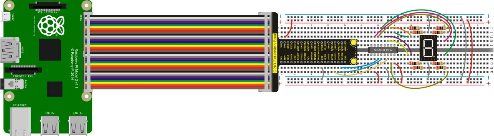
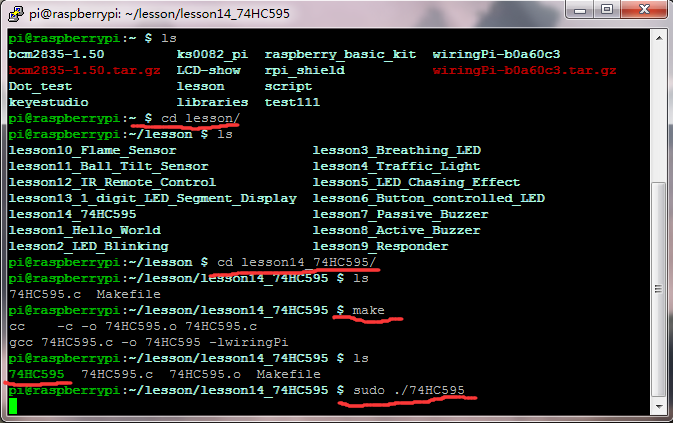

## Lesson 14: 74HC595

1.  Introduction

In the previous project, we use raspberry pi to control 1-digit LED     segment display, occupying 8 GPIO ports. While the GPIO port of     raspberry pi is limited, in order to save the GPIO port, this time     we will use 74HC595 chip to control 1-digit LED segment display only     using 3 GPIO ports.

The wiring and setting method please refer to the following table:

<td colspan="10">74HC595|
||Q7|Q6|Q5|Q4|Q3|Q3|Q1|Q0||
||a|b|c|d|e|f|g|dp||
|0|1|1|1|1|1|1|0|0|252|
|1|0|1|1|0|0|0|0|0|96|
|2|1|1|0|1|1|0|1|0|218|
|3|1|1|1|1|0|0|1|0|242|
|4|0|1|1|0|0|1|1|0|102|
|5|1|0|1|1|0|1|1|0|182|
|6|1|0|1|1|1|1|1|0|190|
|7|1|1|1|0|0|0|0|0|224|
|8|1|1|1|1|1|1|1|0|254|
|9|1|1|1|1|0|1|1|0|246|

2.  Hardware Required

74HC595N\*1

1-digit LED Segment Display \*1

220Ω Resistor\*8

RPI GPIO Shield\*1

40 Pin Colorful Jumper Wires\*1

Breadboard\*1

USB Cable\*1

Raspberry Motherboard\*1

Jumper Wire\*Several

3.  Connection Diagram

4.  Programming

1.  Use winSCP to put the lesson14_74HC595 into the lesson folder of     raspberry system.

2.  In the terminal input cd lesson14_74HC595 to enter the folder.

3.  In the terminal execute make to generate a 74HC595
executable file inside the folder.

4.  Wiring as the above diagram, then enter the lesson14_74HC595 folder,     execute sudo ./74HC595 at the terminal, 1-digit LED segment     display will successively show the number from 0 to 9.

5.  Ctrl + c can exit the processing program.

5.  Sample Code

////////////////////////////////////////////////////////////////////////////////////////////////////////////////////////

\#include \<wiringPi.h\>

\#include \<wiringShift.h\>

int dataPin = 23; //define three pins

int latchPin = 24;

int clockPin = 25;

int a\[10\]={

252,96,218,242,102,182,190,224,254,246};

int x;

int main()

{

wiringPiSetup();

{

pinMode(latchPin,OUTPUT);

pinMode(clockPin,OUTPUT);

pinMode(dataPin,OUTPUT); //three pins as output

}

while(1)

{

for(x=0; x\<10 ;x++ ) //calculate counting function

{

digitalWrite(latchPin,LOW);

shiftOut(dataPin,clockPin,MSBFIRST,a\[x\]); //display array a\[x\]

digitalWrite(latchPin,HIGH);

delay(1000);

}

}

}

////////////////////////////////////////////////////////////////////////////////////////////////////////////////////////

