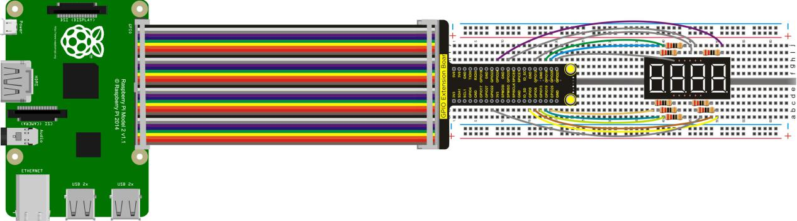
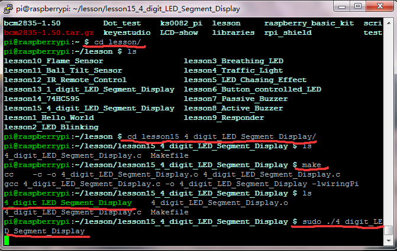

## Lesson 15: 4-digit LED Segment Display

1.  Introduction

We have directly used raspberry pi to drive a 1-digit LED segment     display, and this time we also use it to drive a common cathode     4-digit LED segment display. But it is necessary to use     current-limiting resistor, and there are two connection methods for     it. One is connected to d1-d4 common cathode, in total 4 pieces,     with the advantages of using fewer resistors but displaying     different brightness for different number. Another way is connected     to other 8 pins, displaying consistent brightness but requiring more     resistors. This test will use 8 220Ω resistors.

2.  Hardware Required

4-digit LED\*1

220Ω Resistor\* 8

RPI GPIO Shield\* 1

40 Pin Colorful Jumper Wires\* 1

USB Cable\*1

Raspberry Motherboard\*1

Breadboard\*1

Jumper Wire\* Several

3.  Connection Diagram

4.  Programming

1.  Use winSCP to put the lesson15_4_digit_LED_Segment_Display into     the lesson folder of raspberry system.

2.  In the terminal input cd lesson15_4_digit_LED_Segment_Display to     enter the folder.

3.  In the terminal execute make to generate a     4\_digit_LED_Segment_Display executable file inside the folder.

4.  Wiring as the above diagram, then enter the     lesson15_4_digit_LED_Segment_Display folder, execute sudo     ./4_digit_LED_Segment_Display at the terminal. 4-digit LED segment     display will first show “0000”, displaying jump, and the segment     display value will add one if it jumps at a time. When the display     value is greater than “9999”, it will return to “0000” once again,     [circularly](D:/Dict/7.3.0.0807/resultui/dict/?keyword=circularly)     displaying .

5.  Ctrl + c can exit the processing program.

5.  Sample Code

////////////////////////////////////////////////////////////////////////////////////////////////////////////////////////

\#include \<wiringPi.h\>

int a = 28;// GPIO20

int b = 5; // GPIO24

int c = 22;// GPIO6

int d = 24;// GPIO19

int e = 25;// GPIO26

int f = 27;// GPIO16

int g = 21;// GPIO5

int dp = 23;// GPIO13

int d4 = 3;// GPIO22

int d3 = 6;// GPIO25

int d2 = 26;// GPIO12

int d1 = 29;// GPIO21

// set variable

long n = 1230;

int x = 100;

int del = 55; // fine adjustment for clock

void WeiXuan(unsigned char n)//

{

switch (n)

{

case 1:

digitalWrite(d1, LOW);

digitalWrite(d2, HIGH);

digitalWrite(d3, HIGH);

digitalWrite(d4, HIGH);

break;

case 2:

digitalWrite(d1, HIGH);

digitalWrite(d2, LOW);

digitalWrite(d3, HIGH);

digitalWrite(d4, HIGH);

break;

case 3:

digitalWrite(d1, HIGH);

digitalWrite(d2, HIGH);

digitalWrite(d3, LOW);

digitalWrite(d4, HIGH);

break;

case 4:

digitalWrite(d1, HIGH);

digitalWrite(d2, HIGH);

digitalWrite(d3, HIGH);

digitalWrite(d4, LOW);

break;

default :

digitalWrite(d1, HIGH);

digitalWrite(d2, HIGH);

digitalWrite(d3, HIGH);

digitalWrite(d4, HIGH);

break;

}

}

void Num_0()

{

digitalWrite(a, HIGH);

digitalWrite(b, HIGH);

digitalWrite(c, HIGH);

digitalWrite(d, HIGH);

digitalWrite(e, HIGH);

digitalWrite(f, HIGH);

digitalWrite(g, LOW);

digitalWrite(dp, LOW);

}

void Num_1()

{

digitalWrite(a, LOW);

digitalWrite(b, HIGH);

digitalWrite(c, HIGH);

digitalWrite(d, LOW);

digitalWrite(e, LOW);

digitalWrite(f, LOW);

digitalWrite(g, LOW);

digitalWrite(dp, LOW);

}

void Num_2()

{

digitalWrite(a, HIGH);

digitalWrite(b, HIGH);

digitalWrite(c, LOW);

digitalWrite(d, HIGH);

digitalWrite(e, HIGH);

digitalWrite(f, LOW);

digitalWrite(g, HIGH);

digitalWrite(dp, LOW);

}

void Num_3()

{

digitalWrite(a, HIGH);

digitalWrite(b, HIGH);

digitalWrite(c, HIGH);

digitalWrite(d, HIGH);

digitalWrite(e, LOW);

digitalWrite(f, LOW);

digitalWrite(g, HIGH);

digitalWrite(dp, LOW);

}

void Num_4()

{

digitalWrite(a, LOW);

digitalWrite(b, HIGH);

digitalWrite(c, HIGH);

digitalWrite(d, LOW);

digitalWrite(e, LOW);

digitalWrite(f, HIGH);

digitalWrite(g, HIGH);

digitalWrite(dp, LOW);

}

void Num_5()

{

digitalWrite(a, HIGH);

digitalWrite(b, LOW);

digitalWrite(c, HIGH);

digitalWrite(d, HIGH);

digitalWrite(e, LOW);

digitalWrite(f, HIGH);

digitalWrite(g, HIGH);

digitalWrite(dp, LOW);

}

void Num_6()

{

digitalWrite(a, HIGH);

digitalWrite(b, LOW);

digitalWrite(c, HIGH);

digitalWrite(d, HIGH);

digitalWrite(e, HIGH);

digitalWrite(f, HIGH);

digitalWrite(g, HIGH);

digitalWrite(dp, LOW);

}

void Num_7()

{

digitalWrite(a, HIGH);

digitalWrite(b, HIGH);

digitalWrite(c, HIGH);

digitalWrite(d, LOW);

digitalWrite(e, LOW);

digitalWrite(f, LOW);

digitalWrite(g, LOW);

digitalWrite(dp, LOW);

}

void Num_8()

{

digitalWrite(a, HIGH);

digitalWrite(b, HIGH);

digitalWrite(c, HIGH);

digitalWrite(d, HIGH);

digitalWrite(e, HIGH);

digitalWrite(f, HIGH);

digitalWrite(g, HIGH);

digitalWrite(dp, LOW);

}

void Num_9()

{

digitalWrite(a, HIGH);

digitalWrite(b, HIGH);

digitalWrite(c, HIGH);

digitalWrite(d, HIGH);

digitalWrite(e, LOW);

digitalWrite(f, HIGH);

digitalWrite(g, HIGH);

digitalWrite(dp, LOW);

}

void Clear() // clear the screen

{

digitalWrite(a, LOW);

digitalWrite(b, LOW);

digitalWrite(c, LOW);

digitalWrite(d, LOW);

digitalWrite(e, LOW);

digitalWrite(f, LOW);

digitalWrite(g, LOW);

digitalWrite(dp, LOW);

}

void pickNumber(unsigned char n)// select number

{

switch (n)

{

case 0: Num_0();

break;

case 1: Num_1();

break;

case 2: Num_2();

break;

case 3: Num_3();

break;

case 4: Num_4();

break;

case 5: Num_5();

break;

case 6: Num_6();

break;

case 7: Num_7();

break;

case 8: Num_8();

break;

case 9: Num_9();

break;

default: Clear();

break;

}

}

void Display(unsigned char x, unsigned char Number)// take x as coordinate and display number

{

WeiXuan(x);

pickNumber(Number);

delay(1);

Clear() ; // clear the screen

}

int i;

int main()

{

wiringPiSetup();

{

{

pinMode(3,OUTPUT);

pinMode(5,OUTPUT);

pinMode(6,OUTPUT);

}

for(i=21;i\<=29;i++)

{

pinMode(i,OUTPUT);

}

}

while(1)

{

int w=0;

int s=0;

int y=0;

int z=0;

unsigned long currentMillis = millis();

while(z\>=0)

{

while(millis()-currentMillis\<100)

{

Display(1,w);

Display(2,s);

Display(3,y);

Display(4,z);

}

currentMillis = millis();

z++;

if (z\>9)

{

y++;

z=0;

}

if (y\>9)

{

s++;

y=0;

}

if (s\>9)

{

w++;

s=0;

}

if (w\>9)

{

w=0;

s=0;

y=0;

z=0;

}

}

}

}

////////////////////////////////////////////////////////////////////////////////////////////////////////////////////////

