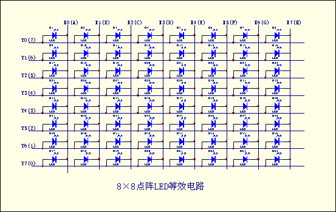
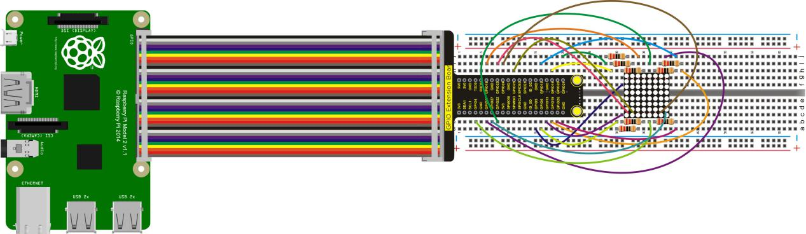
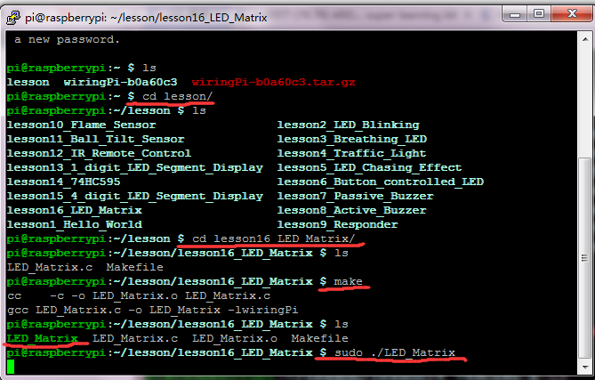

## Lesson 16: LED Matrix Display

1.  Introduction

This project, we are going to display various patterns by controlling a 8\*8 LED Matrix. Supposed that it is only controlled by raspberry pi, so we just need to control 8-row 8-column in total 16 GPIO ports. Since GPIO port is limited and to save it, this time we use two 74HC595 chips to control 8\*8 LED Matrix, one for 8-row, the other for 8-column, only using 3 GPIO ports.

Schematics of 8\*8 LED Matrix:

2.  Hardware Required

8\*8 LED Matrix\*1

220Ω Resistor\*8

RPI GPIO Shield\*1

40 pin Colorful Jumper Wires\*1

Breadboard\*1

USB Cable\*1

Raspberry Motherboard\*1

Jumper Wire\* Several

3.  Connection Diagram

4.  Programming

1.  Use winSCP to put the lesson16_LED_Matrix into the lesson folder     of raspberry system.

2.  In the terminal input cd lesson16_LED_Matrix to enter the     folder.

3.  In the terminal execute make to generate an LED_Matrix
executable file inside the folder.

4.  Wiring as the above diagram, then enter the lesson16_LED_Matrix     folder, execute sudo ./LED_Matrix at the terminal. 8\*8 LED     Matrix will show GIF image.

5.  Ctrl + c can exit the processing program.

5.  Sample Code

///////////////////////////////////////////////////////////////////////////////////////////////////////////////////////////

\#include \<wiringPi.h\>

int main()

{

wiringPiSetup();

char i;

char j;

for(i=0;i\<8;i++)

{

pinMode(i,OUTPUT);

}

for(j=21;j\<29;j++)

{

pinMode(j,OUTPUT);

}

while(1)

{

for(i=0;i\<8;i++)

{

digitalWrite(i, HIGH);// set I/O pins as “high”

delay(200); // delay

}

for(j=21;j\<29;j++)

{

digitalWrite(j, LOW);// set I/O pins as “low”

}

for(i=0;i\<8;i++)

{

digitalWrite(i, LOW);// set I/O pins as “high”

delay(200); // delay

}

for(i=0;i\<8;i++)

{

digitalWrite(i, HIGH);// set I/O pins as “high”

delay(200); // delay

}

for(j=21;j\<29;j++)

{

digitalWrite(j,HIGH);// set I/O pins as “high”

delay(200); // delay

}

for(j=21;j\<29;j++)

{

digitalWrite(j, LOW);// set I/O pins as “low”

delay(200); // delay

}

for(i=0;i\<8;i++)

{

digitalWrite(i, LOW);// set I/O pins as “low”

delay(200); // delay

}

}

}

/////////////////////////////////////////////////////////////////////////////////////////////////////////////////////////

