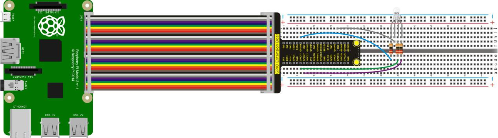
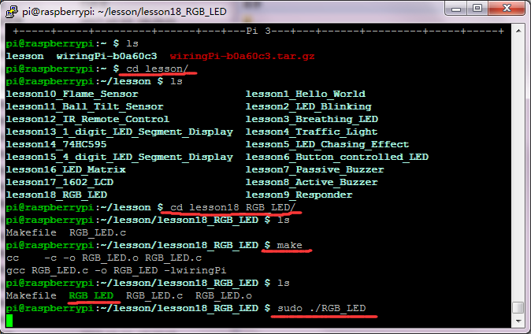

## Lesson 18: RGB LED

1.  Introduction

We have controlled the color change of RGB light by controlling the     raspberry pi. To achieve RGB LED controlling, it needs 3-channel     PWM, while raspberry pi only has one way hardware PWM output     (GPIO1). In the experiment, we use the wiringPi library to configure     GPIO0, GPIO1, GPIO2 as soft PWM output.

2.  Hardware Required

RGB - LED \*1

220Ω Resistor \*3

RPI GPIO Shield \*1

40 Pin Colorful Jumper Wires\*1

USB Cable\*1

Breadboard\*1

Raspberry Motherboard\*1

Jumper Wire\*Several

3.  Connection Diagram

4.  Programming

1.  Use winSCP to put the lesson18_RGB_LED into the lesson folder of     raspberry system.

2.  In the terminal input cd lesson18_RGB_LED to enter the folder.

3.  In the terminal execute make to generate an RGB_LED
executable file inside the folder.

4.  Wiring as the above diagram, then enter the lesson18_RGB_LED folder,     execute sudo ./RGB_LED at the terminal. RGB light will display     different colors.

5.  Ctrl + c can exit the processing program.

5.  Sample Code

////////////////////////////////////////////////////////////////////////////////////////////////////////////////////////

\#include \<wiringPi.h\>

\#include \<softPwm.h\>

\#include \<stdio.h\>

\#define LedPinRed 0

\#define LedPinGreen 1

\#define LedPinBlue 2

int colors\[\] = {0xFF0000, 0x00FF00, 0x0000FF, 0xFFFF00, 0x00FFFF,     0xFF00FF, 0xFFFFFF, 0x9400D3};

/\*\*\*\*\*\*\*\*\*\*\*\*\*\*\*\*\*\*\*\*\*\*\*\*\*\*\*\*\*\*\*\*\*\*\*\*\*\*\*\*\*\*\*\*\*\*\*\*\*\*\*\*\*\*\*\*\*\*\*\*\*\*\*\*\*\*\*\*\*\*\*\*\*\*\*\*\*\*\*\*\*\*\*\*\*\*\*\*\*\*

\*A number is linear mapped from a range to another one, for     example, a number from 0 to 100 is mapped to 0 ~ 255.

\*\*\*\*\*\*\*\*\*\*\*\*\*\*\*\*\*\*\*\*\*\*\*\*\*\*\*\*\*\*\*\*\*\*\*\*\*\*\*\*\*\*\*\*\*\*\*\*\*\*\*\*\*\*\*\*\*\*\*\*\*\*\*\*\*\*\*\*\*\*\*\*\*\*\*\*\*\*\*\*\*\*\*\*\*\*\*\*\*\*/

int map(int x, int in_min, int in_max, int out_min, int out_max)

{

return (x -in_min) \* (out_max - out_min) / (in_max - in_min) +
out_min;

}

void ledInit(void)

{

softPwmCreate(LedPinRed, 0, 100); //create a soft pwm, original duty     cycle is 0Hz, range is 0~100

softPwmCreate(LedPinGreen,0, 100);

softPwmCreate(LedPinBlue, 0, 100);

}

void ledColorSet(int color) //set color, for example: 0xde3f47

{

int r_val, g_val, b_val;

r_val = (color & 0xFF0000) \>\> 16; //get red value

g_val = (color & 0x00FF00) \>\> 8; //get green value

b_val = (color & 0x0000FF) \>\> 0; //get blue value

r_val = map(r_val, 0, 255, 0, 100); //change a num(0~255) to 0~100

g_val = map(g_val, 0, 255, 0, 100);

b_val = map(b_val, 0, 255, 0, 100);

softPwmWrite(LedPinRed, 100 - r_val); //change duty cycle

softPwmWrite(LedPinGreen, 100 - g_val);

softPwmWrite(LedPinBlue, 100 - b_val);

}

int main(void)

{

int i;

if(wiringPiSetup() == -1){ //when initialize wiringPi failed, print     message to screen

printf("setup wiringPi failed !\n");

return 1;

}

ledInit();

while(1){

for(i = 0; i \< sizeof(colors)/sizeof(int); i++){

ledColorSet(colors\[i\]);

delay(500);

}

}

return 0;

}

////////////////////////////////////////////////////////////////////////////////////////////////////////////////////////

