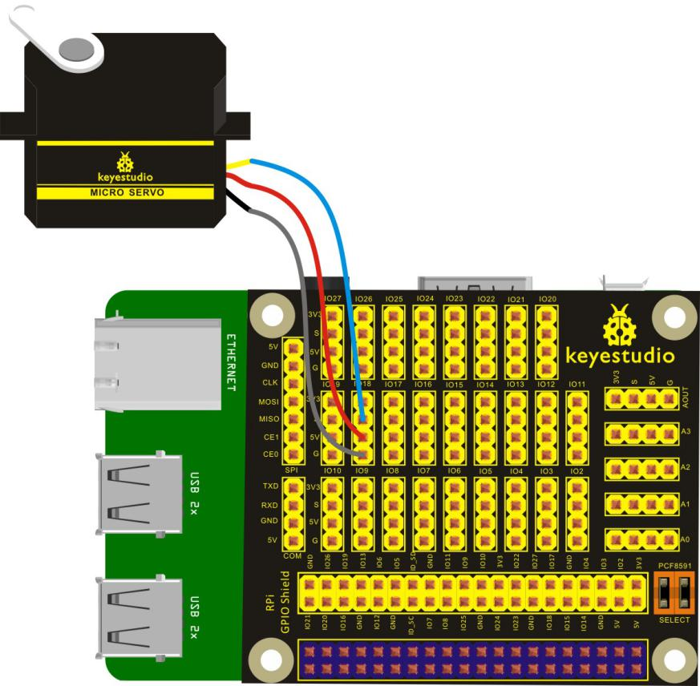
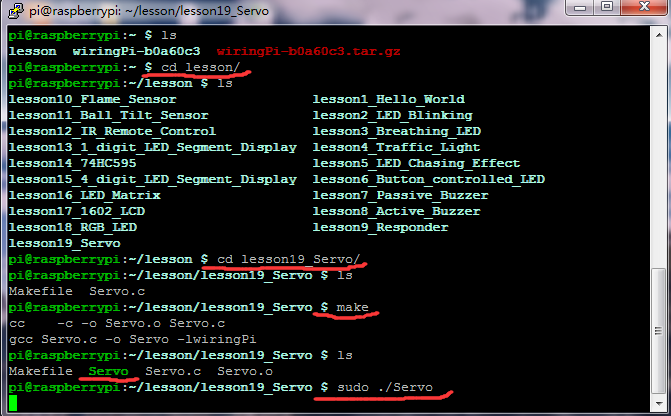

## Lesson 19: 9g Servo Control

1.  Introduction

The rotate angle of servo motor is controlled by regulating the duty     cycle of the PWM (Pulse-Width Modulation) signal. The standard cycle     of the PWM signal is 20ms (50Hz). In the experiment, we use two     signals with 1ms~2ms of pulse width and 20ms of cycle, to control     the rotation of servo motor, making it swings back and forth at the     corresponding angle of the two signals.

2.  Hardware Required

Servo Motor\*1

Keyestudio RPI GPIO-PCF8591 Shield\*1

USB Cable\*1

Raspberry Motherboard\*1

3.  Connection Diagram

4. Programming

1.  Use winSCP to put the lesson19_Servo into the lesson folder of     raspberry system.

2.  In the terminal, input cd lesson19_Servo to enter the folder.

3.  In the terminal, execute make to generate a Servo executable     file inside the folder.

4.  Wiring as the above diagram, then enter the lesson19_Servo folder,     execute sudo ./Servo at the terminal. Servo motor will     swing continually.

5.  Ctrl + c can exit the processing program.

5.  Source Code

////////////////////////////////////////////////////////////////////////////////////////////////////////////////////////

\#include \<wiringPi.h\>

int main()

{

wiringPiSetup();

pinMode(1,OUTPUT);

int i;

for(;;)

{

for(i=0;i\<50;i++)

{

digitalWrite(1,HIGH);

delayMicroseconds(1000);

digitalWrite(1,LOW);

delay(19);

}

delay(1000);

for(i=0;i\<50;i++)

{

digitalWrite(1,HIGH);

delayMicroseconds(2000);

digitalWrite(1,LOW);

delay(18);

}

delay(1000);

}

return 0;

}

////////////////////////////////////////////////////////////////////////////////////////////////////////////////////////

