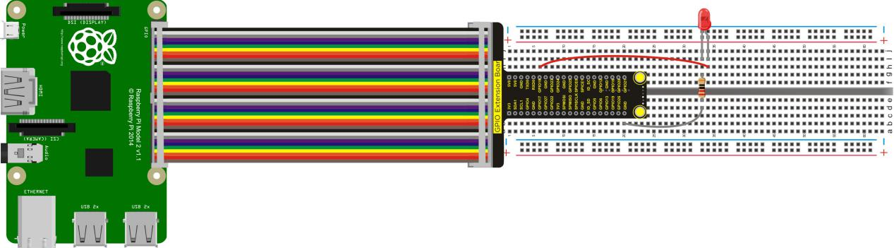
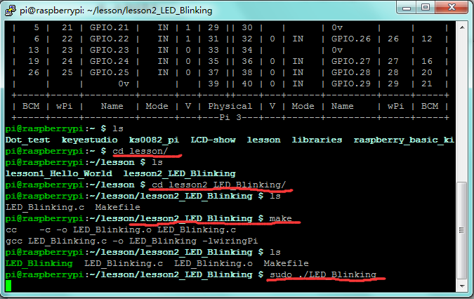

## Lesson 2: LED Blinking

1.  Introduction

LED small light experiment is one of the more basic experiments. In     this lesson, we will use I/O port of Raspberry Pi to simply control     red LED blinking.

2.  Hardware Required

Red LED \*1

220ΩResistor\*1

RPI GPIO Shield\*1

40 Pin Colorful Jumper Wire\*1

Breadboard\*1

USB Cable\*1

Raspberry Motherboard\*1

Jumper Wires\* several

3.  Connection Diagram



4.  Programming

1.  Use winSCP to put the lesson2_LED_Blinking into the lesson     folder of raspberry system.

2.  In the terminal input cd lesson2_LED_Blinking to enter the     folder.

3.  In the terminal execute make, generating an LED_Blinking
executable file inside the folder.

4.  Wiring as the above diagram, then enter the lesson2_LED_Blinking
folder, execute sudo ./LED_Blinking on the terminal, and you can     see the LED blinking effect.

5.  Ctrl + c can exit the processing program.




5.  Sample Code

```c
#include <wiringPi.h>
int main()
{
  wiringPiSetup();

  {
        pinMode(1,OUTPUT);
  }
  
  while(1)
  { 
        digitalWrite(1,HIGH);
        delay(500);
        digitalWrite(1,LOW);
        delay(500);	  
  }
	
}

```


