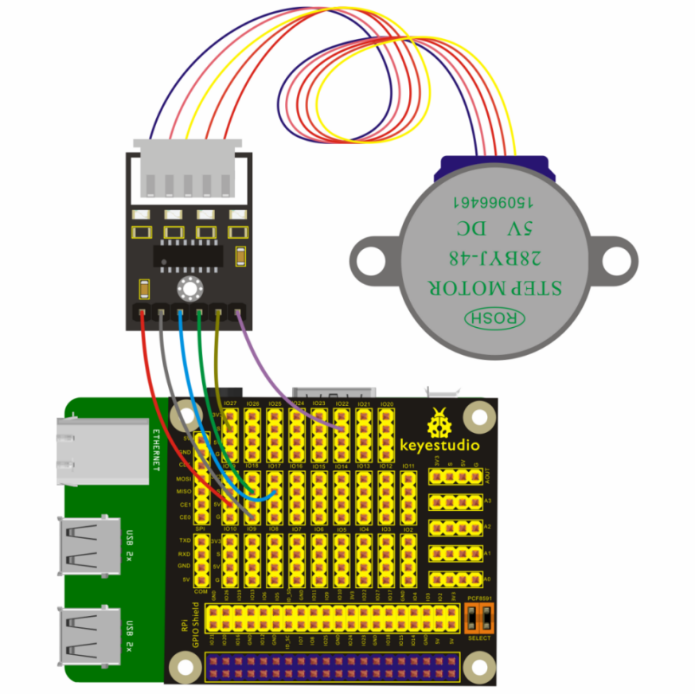
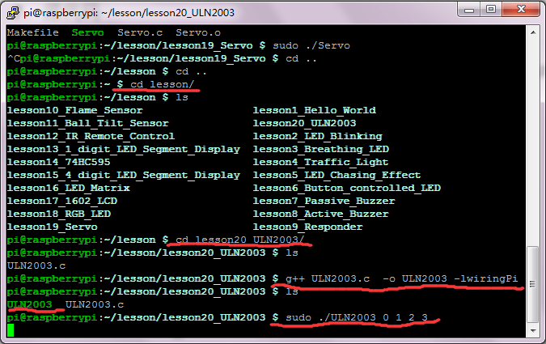

## Lesson 20: ULN2003 Stepper Motor

1.  Introduction

In this lesson, we will drive the stepper motor to turn only one     circle by directly connecting ULN2003 Stepper Motor Driver to RPI     GPIO-PCF8591 Shield.

2. Hardware Required

Keyestudio 5V 4-Phase Stepper Motor + Driver Board ULN2003\*1

Keyestudio RPI GPIO-PCF8591 Shield\*1

USB Cable\*1

Raspberry Motherboard\*1

Dupont Wires\* Several

3.  Connection Diagram

4.  Programming

1.  Use winSCP to put the lesson20_ULN2003 into the lesson folder of     raspberry system.

2.  In the terminal, input cd lesson and cd lesson20_ULN2003 to     enter the folder.

3.  Wiring as the above diagram, then enter the lesson20_ULN2003 folder,     execute the below command, it can drive the stepper motor to turn     one circle.

g++ ULN2003.c -o ULN2003 -lwiringPi

sudo ./ULN2003 0 1 2 3

5.  Sample Code

////////////////////////////////////////////////////////////////////////////////////////////////////////////////////////

/\* moto.c

\* A program to control a stepper motor through the GPIO on     Raspberry Pi.

\* Author: Darran Zhang (http://www.codelast.com)

\*/

\#include \<wiringPi.h\>

\#include \<stdio.h\>

\#include \<unistd.h\>

\#include \<stdlib.h\>

\#define CLOCKWISE 1

\#define COUNTER_CLOCKWISE 2

void delayMS(int x);

void rotate(int\* pins, int direction);

int main(int argc,char\* argv\[\]) {

if (argc \< 4) {

printf("Usage example: ./motor 0 1 2 3 \n");

return 1;

}

/\* number of the pins which connected to the stepper motor driver     board \*/

int pinA = atoi(argv\[1\]);

int pinB = atoi(argv\[2\]);

int pinC = atoi(argv\[3\]);

int pinD = atoi(argv\[4\]);

int pins\[4\] = {pinA, pinB, pinC, pinD};

if (-1 == wiringPiSetup()) {

printf("Setup wiringPi failed!");

return 1;

}

/\* set mode to output \*/

pinMode(pinA, OUTPUT);

pinMode(pinB, OUTPUT);

pinMode(pinC, OUTPUT);

pinMode(pinD, OUTPUT);

delayMS(50); // wait for a stable status

for (int i = 0; i \< 500; i++) {

rotate(pins, CLOCKWISE);

}

return 0;

}

/\* Suspend execution for x milliseconds intervals.

\* @param ms Milliseconds to sleep.

\*/

void delayMS(int x) {

usleep(x \* 1000);

}

/\* Rotate the motor.

\* @param pins A pointer which points to the pins number array.

\* @param direction CLOCKWISE for clockwise rotation,     COUNTER_CLOCKWISE for counter clockwise rotation.

\*/

void rotate(int\* pins, int direction) {

for (int i = 0; i \< 4; i++) {

if (CLOCKWISE == direction) {

for (int j = 0; j \< 4; j++) {

if (j == i) {

digitalWrite(pins\[3 - j\], 1); // output a high level

} else {

digitalWrite(pins\[3 - j\], 0); // output a low level

}

}

} else if (COUNTER_CLOCKWISE == direction) {

for (int j = 0; j \< 4; j++) {

if (j == i) {

digitalWrite(pins\[j\], 1); // output a high level

} else {

digitalWrite(pins\[j\], 0); // output a low level

}

}

}

delayMS(4);

}

}

////////////////////////////////////////////////////////////////////////////////////////////////////////////////////////

