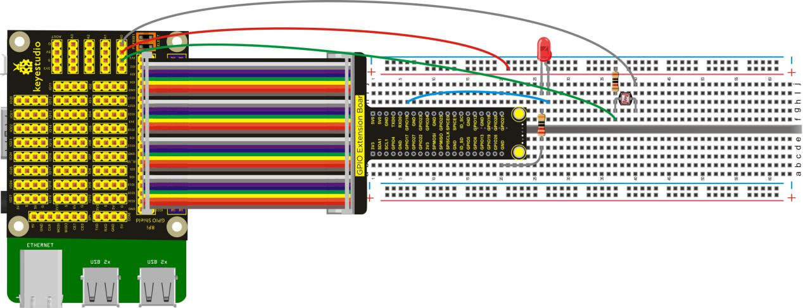
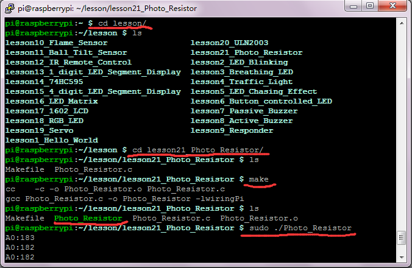

## Lesson 21: Photo Resistor

1.  Introduction

In the lesson, we will connect Photo Resistor to Keyestudio RPI     GPIO-PCF8591 Shield to test the extended AD function of raspberry     pi. We will directly connect an external photo resistor to test the     illumination intensity, and then use the measured value to control     LED’s on and off.

2.  Hardware Required

Photo Resistor\*1

LED - Red\*1

10KΩ Resistor\*1

220Ω Resistor\*1

RPI GPIO Shield\*1

40 Pin Colorful Jumper Wires\*1

Keyestudio RPI GPIO-PCF8591 Shield\*1

Breadboard\*1

USB Cable\*1

Raspberry Motherboard\*1

Jumper Breadboard Wires\* Several

Dupont Wire\* Several

3.  Connection Diagram

4.  Programming

1.  Raspberry pi default not open the I2C function, on the terminal,     input sudo raspi-config to open raspberry configuration     interface.

2.  Select the 7 Advanced Options, then select the A7 I2C option to     enable the raspberry pi I2C function.

3.  Use winSCP to put the lesson21_Photo_Resistor into the lesson     folder of raspberry system.

4.  In the terminal, input cd lesson and cd     lesson21_Photo_Resistor to enter the folder.

5.  In the terminal, execute make to generate a Photo_Resistor
executable file inside the folder.

6.  Wiring as the above diagram, then enter the lesson21_Photo_Resistor     folder, execute sudo ./Photo_Resistor at the terminal. Then, you     can see the value(0-255) representing the illumination intensity;
when the value is greater than 150, LED lights up.

7.  Ctrl + c can exit the processing program.

Please refer to the figure below:

5.  Source Code

////////////////////////////////////////////////////////////////////////////////////////////////////////////////////////

\#include \<wiringPi.h\>

\#include \<pcf8591.h\>

\#include \<stdio.h\>

\#define Address 0x48

\#define BASE 64

\#define A0 BASE+0

\#define A1 BASE+1

\#define A2 BASE+2

\#define A3 BASE+3

int main(void)

{

unsigned char value;

wiringPiSetup();

pinMode(1,OUTPUT);

pcf8591Setup(BASE,Address);

while(1)

{

value=analogRead(A0);

printf("A0:%d\n",value);

delay(100);

if(value\>150)

{

digitalWrite(1,HIGH);

delay(100);

}

else

{

digitalWrite(1,LOW);

}

}

}

////////////////////////////////////////////////////////////////////////////////////////////////////////////////////////

