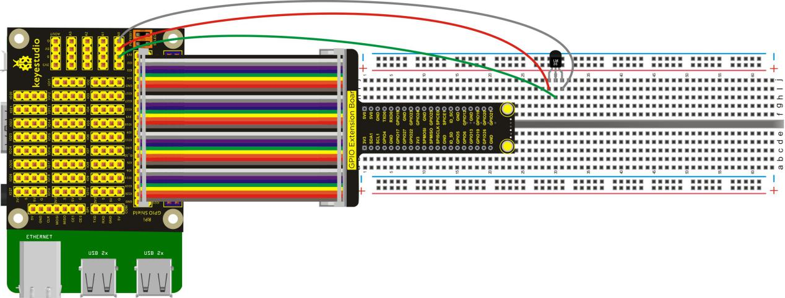
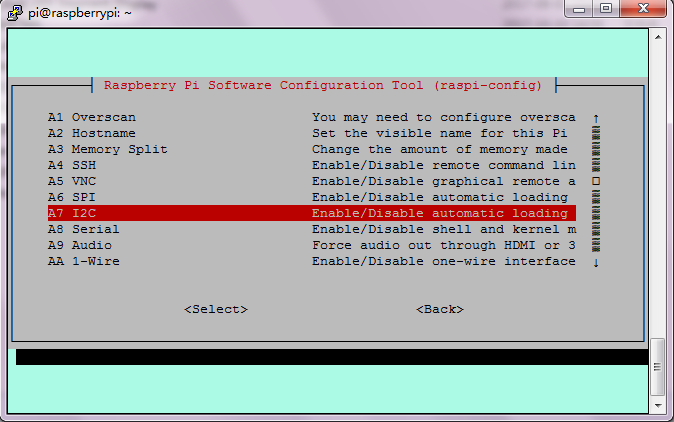
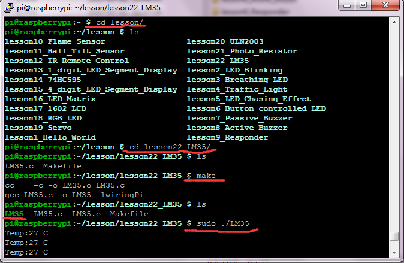

## Lesson 22: LM35 Temp Sensor

1.  Introduction

This lesson will use AD transfer function of RPI GPIO-PCF8591     Shield. In the test, we will directly connect an external LM35 Temp     Sensor to test the current temperature, you can see the     corresponding value on the terminal of raspberry pi.

2.  Hardware Required

   LM35 Temp Sensor\*1

RPI GPIO Shield\*1

40 pin Colorful Jumper Wires\*1

Keyestudio RPI GPIO-PCF8591 Shield\*1

Breadboard\*1

USB Cable \* 1

   Raspberry Motherboard \* 1

Dupont Wires\* several

3.  Connection Diagram

4.  Programming

1.  Raspberry pi default not open the I2C function, on the terminal,     input sudo raspi-config to open raspberry configuration     interface.

2.  Select the 7 Advanced Options, then select the A7 I2C option to     enable the raspberry pi I2C function.

3.  Use winSCP to put the lesson22_LM35 into the lesson folder of     raspberry system.

4.  In the terminal, input cd lesson and cd lesson22_LM35 to     enter the folder.

5.  In the terminal, execute make to generate LM35 executable     file inside the folder.

6.  Wiring as the above diagram, then enter the lesson22_LM35 folder,     execute sudo ./LM35 at the terminal. Then, you can see the temp     value of current environment.

Please refer to the figure below:

5.  Source Code

////////////////////////////////////////////////////////////////////////////////////////////////////////////////////////

\#include \<wiringPi.h\>

\#include \<pcf8591.h\>

\#include \<stdio.h\>

\#define Address 0x48

\#define BASE 64

\#define A0 BASE+0

\#define A1 BASE+1

\#define A2 BASE+2

\#define A3 BASE+3

int main(void)

{

unsigned char value;

wiringPiSetup();

pcf8591Setup(BASE,Address);

while(1)

{

value=analogRead(A0);

value=(500 \* value) /256;

printf("Temp:%d C\n",value);

delay(50);

}

}

////////////////////////////////////////////////////////////////////////////////////////////////////////////////////////

