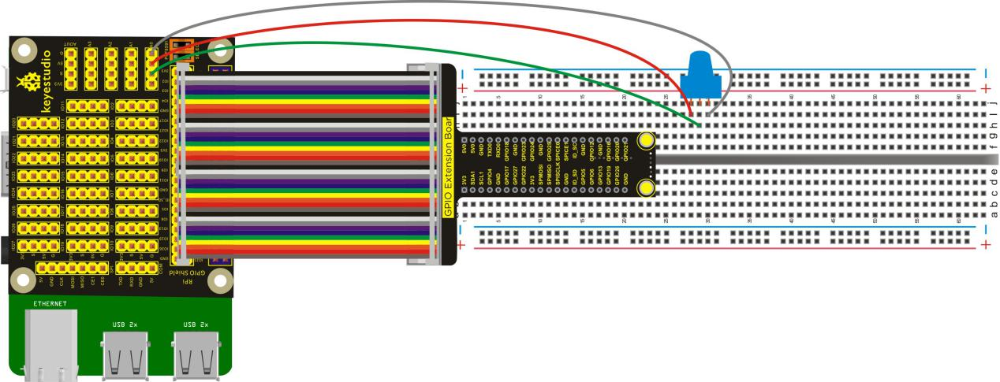
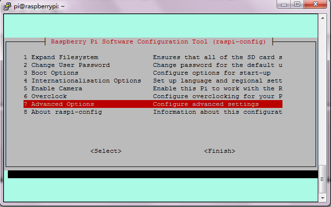
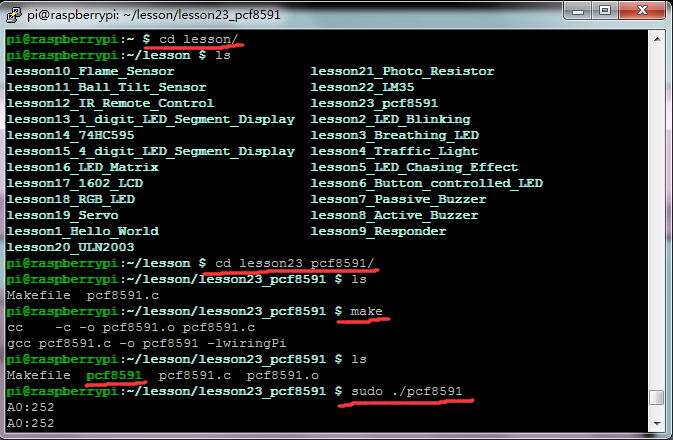

## Lesson 23: pcf8591

1.  Introduction

Raspberry Pi itself does not have AD/ DA function, and if the     raspberry pi need to connect an external analog sensor, it first     must connect an external AD / DA function expansion board. This     pcf8591 can use the I2C interface of raspberry pi to extend the     4-way AD and 1-way DA.

In this course, we will connect a 10KΩ potentiometer to the     Keyestudio RPI GPIO-PCF8591 Shield to test the extended AD function     of raspberry pi.

2.  Hardware Required

  10KΩ Potentiometer\*1

RPI GPIO Shield\*1

40 pin Colorful Jumper Wires\*1

Keyestudio RPI GPIO-PCF8591 Shield\*1

Breadboard\*1

USB Cable \* 1

   Raspberry Motherboard \* 1

Dupont Wires\* several

3.  Connection Diagram

4.  Programming

1.  Raspberry pi default not open the I2C function, on the terminal,     input sudo raspi-config to open raspberry configuration     interface.

2.  Select the 7 Advanced Options, then select the A7 I2C option to     enable the raspberry pi I2C function.

3.  Use winSCP to put the lesson23_pcf8591into the lesson folder of     raspberry system.

4.  In the terminal, input cd lesson and cd lesson23_pcf8591 to     enter the folder.

5.  In the terminal, execute make to generate a pcf8591
executable file inside the folder.

6.  Wiring as the above diagram, enter the lesson23_pcf8591 folder, then     execute sudo ./pcf8591 at the terminal. Then, you can see the     corresponding value（0-255）on the terminal.

7.  Ctrl + c can exit the processing program.

Please refer to the figure below:

5.  Source Code

////////////////////////////////////////////////////////////////////////////////////////////////////////////////////////

\#include \<wiringPi.h\>

\#include \<pcf8591.h\>

\#include \<stdio.h\>

\#define Address 0x48 //pcf8591 Address

\#define BASE 64

\#define A0 BASE+0 //input address of A0

\#define A1 BASE+1 //input address of A1

\#define A2 BASE+2 //input address of A2

\#define A3 BASE+3 //input address of A3

int main(void)

{

unsigned char value;

wiringPiSetup();

pcf8591Setup(BASE,Address); //configure pcf8591

while(1)

{

value=analogRead(A0); // read the value of A0 port

printf("A0:%d\n",value); // print the value of A0 on the terminal

delay(100);

}

}

////////////////////////////////////////////////////////////////////////////////////////////////////////////////////////

