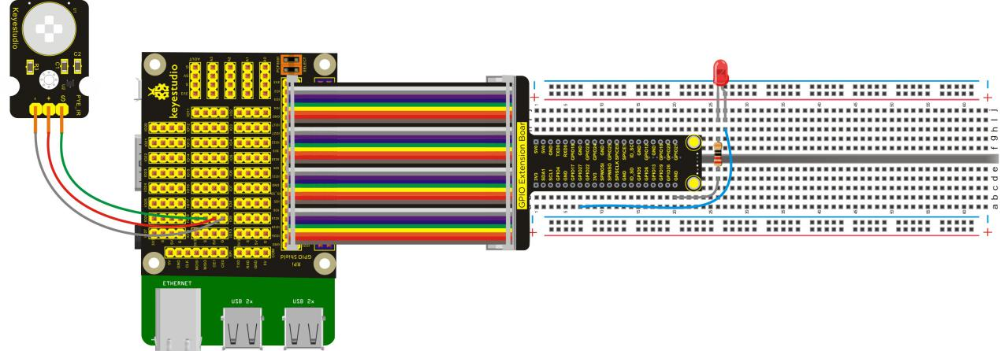
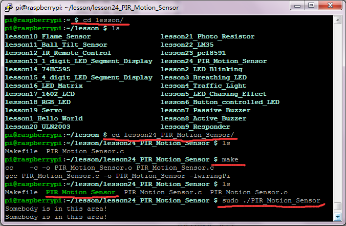

## Lesson 24: PIR Motion Sensor

1.  Introduction

In this lesson, we will use PIR Motion Sensor to detect whether     there is someone moving nearby. If someone moves nearby, LED will     light up, and the terminal prints the character "Somebody is in this     area!". Otherwise, LED will go out and the terminal will print the     character "No one!".

2.  Hardware Required

PIR Motion Sensor\*1

LED - Red\*1

220Ω Resistor\*1

RPI GPIO Shield\*1

40 pin Colorful Jumper Wires\*1

Keyestudio RPI GPIO-PCF8591 Shield\*1

Breadboard\*1

USB Cable \* 1

   Raspberry Motherboard \* 1

Jumper Wires \* several

Dupont Wires\* several

3.  Connection Diagram

4.  Programming

1.  Use winSCP to put the lesson24_PIR_Motion_Sensor into the lesson     folder of raspberry system.

2.  In the terminal, input cd lesson24_PIR_Motion_Sensor to enter     the folder.

3.  In the terminal, execute make to generate PIR_Motion_Sensor
executable file inside the folder.

4.  Wiring as the above diagram, then enter the     lesson24_PIR_Motion_Sensor folder, execute sudo     ./PIR_Motion_Sensor at the terminal. It can detect any movement     nearby.

5.  Ctrl + c can exit the processing program.

5.  Source Code

////////////////////////////////////////////////////////////////////////////////////////////////////////////////////////

\#include \<wiringPi.h\>

\#include \<stdio.h\>

int main()

{

wiringPiSetup();

char val;

{

pinMode(1,INPUT);

pinMode(2,OUTPUT);

}

while(1)

{

val=digitalRead(1);

if(val==1)

{

printf("Somebody is in this area!\n");

digitalWrite(2,HIGH);

delay(100);

}

else

{

printf("No one!\n");

digitalWrite(2,LOW);

delay(100);

}

}

}

////////////////////////////////////////////////////////////////////////////////////////////////////////////////////////

