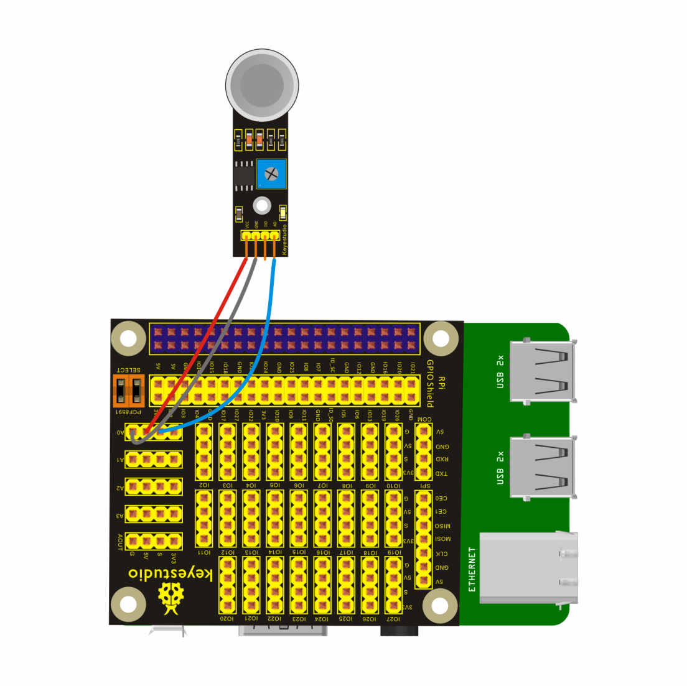
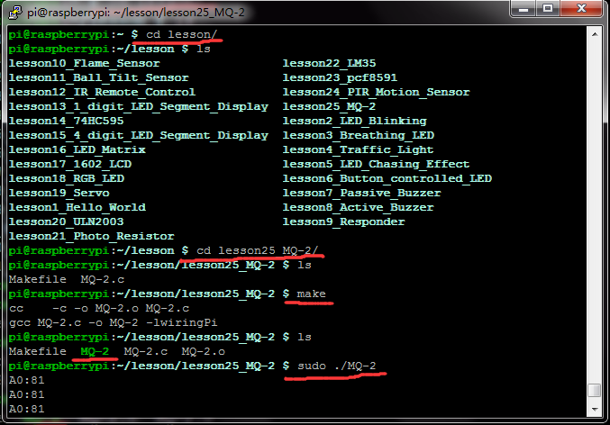

## Lesson 25: MQ-2 Analog Gas Sensor

1.  Introduction

In the previous lesson, we have connected the Analog Rotation Sensor     to the Keyestudio RPI GPIO-PCF8591 Shield to test the     raspberry-extended AD function. In this lesson, we will directly     connect an external MQ-2 sensor module to test the liquefied     petroleum gas, propane, hydrogen and other gas content in the air,     and you can see the corresponding value at the raspberry pi     terminal.

2.  Hardware Required

Analog Gas Sensor\*1

Keyestudio RPI GPIO-PCF8591 Shield\*1

USB Cable \* 1

   Raspberry Motherboard \* 1

Dupont Wires\* several

3.  Connection Diagram

4.  Programming

1.  Raspberry pi default not open the I2C function, on the terminal,     input sudo raspi-config to open raspberry pi configuration     interface.

2.  Select the 7 Advanced Options, then select the A7 I2C option to     enable the raspberry pi I2C function.

3.  Use winSCP to put the lesson25_MQ-2 into the lesson folder of     raspberry system.

4.  In the terminal, input cd lesson and cd lesson25_MQ-2 to     enter the folder.

5.  In the terminal, execute make to create a MQ-2 executable     file inside the folder.

6.  Wiring as the above diagram, then enter the lesson25_MQ-2 folder,     execute sudo ./MQ-2 at the terminal.

Then, on the terminal, you can see the value（0-255）representing     the gas content. There are two LEDs on the sensor, including one     power indicator, and one digital output indicator. And you can     adjust the sensitivity by rotating the potentiometer. When the     sensor doesn’t detect gas, digital LED is off and digital port     outputs high level; while detecting the gas, digital LED lights up     and digital port outputs low level.

7.  Ctrl + c can exit the processing program.

Please refer to the figure below:

5.  Source Code

////////////////////////////////////////////////////////////////////////////////////////////////////////////////////////

\#include \<wiringPi.h\>

\#include \<pcf8591.h\>

\#include \<stdio.h\>

\#define Address 0x48

\#define BASE 64

\#define A0 BASE+0

\#define A1 BASE+1

\#define A2 BASE+2

\#define A3 BASE+3

int main(void)

{

unsigned char value;

wiringPiSetup();

pinMode(1,OUTPUT);

pcf8591Setup(BASE,Address);

while(1)

{

value=analogRead(A0);

printf("A0:%d\n",value);

delay(100);

}

}

////////////////////////////////////////////////////////////////////////////////////////////////////////////////////////

