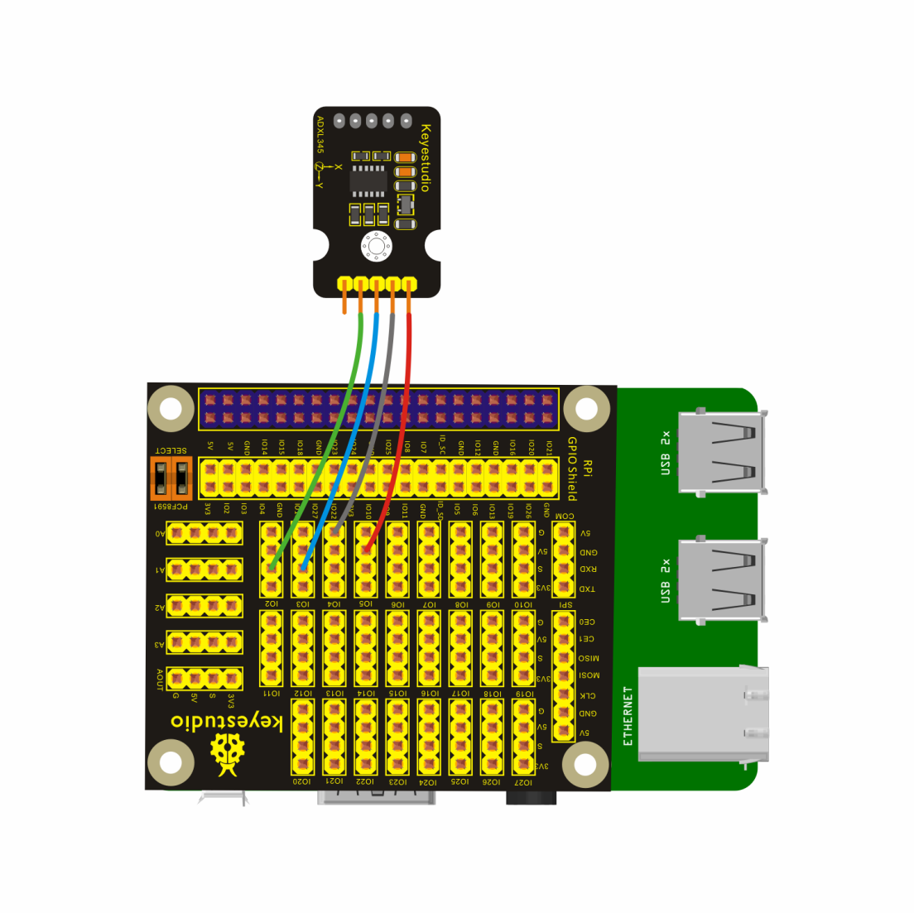
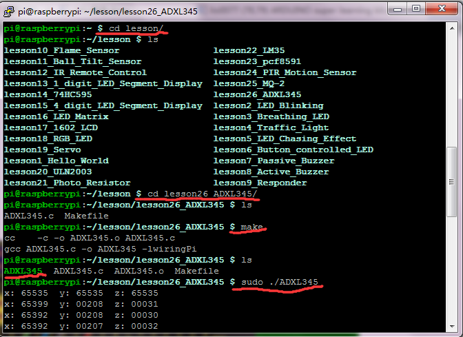

## Lesson 26: ADXL345 Acceleration Module

1.  Introduction

In this course, we will directly connect ADXL345 Three Axis     Acceleration Module to the Keyestudio RPI GPIO-PCF8591 Shield, then     swing ADXL345, getting different three-axis value in the terminal.

2.  Hardware Required

ADXL345 Three Axis Acceleration Module\*1

Keyestudio RPI GPIO-PCF8591 Shield\*1

USB Cable \* 1

   Raspberry Motherboard \* 1

Dupont Wires\* several

3.  Connection Diagram

4.  Programming

1.  Raspberry pi default not open the I2C function, on the terminal,     input sudo raspi-config to open raspberry configuration     interface.

2.  Select the 7 Advanced Options, then select the A7 I2C option to     enable the raspberry pi I2C function.

3.  Use winSCP to put the lesson26_ADXL345 into the lesson folder of     raspberry system.

4.  In the terminal, input cd lesson and cd lesson26_ADXL345 to     enter the folder.

5.  In the terminal, execute make to generate an ADXL345
executable file inside the folder.

6.  Wiring as the above diagram, then enter the lesson26_ADXL345 folder,     execute sudo ./ADXL345 at the terminal. Then, swing ADXL345     sensor, you can get different three-axis value in the terminal.

7.  Ctrl + c can exit the processing program.

Please refer to the figure below:

5.  Source Code

////////////////////////////////////////////////////////////////////////////////////////////////////////////////////////

\#include \<wiringPiI2C.h\>

\#include \<stdio.h\>

\#include \<stdlib.h\>

\#include \<errno.h\>

\#define DevAddr 0x53 //device address

struct acc_dat{

int x;

int y;

int z;

};

void adxl345_init(int fd)

{

wiringPiI2CWriteReg8(fd, 0x31, 0x0b);

wiringPiI2CWriteReg8(fd, 0x2d, 0x08);

// wiringPiI2CWriteReg8(fd, 0x2e, 0x00);

wiringPiI2CWriteReg8(fd, 0x1e, 0x00);

wiringPiI2CWriteReg8(fd, 0x1f, 0x00);

wiringPiI2CWriteReg8(fd, 0x20, 0x00);

wiringPiI2CWriteReg8(fd, 0x21, 0x00);

wiringPiI2CWriteReg8(fd, 0x22, 0x00);

wiringPiI2CWriteReg8(fd, 0x23, 0x00);

wiringPiI2CWriteReg8(fd, 0x24, 0x01);

wiringPiI2CWriteReg8(fd, 0x25, 0x0f);

wiringPiI2CWriteReg8(fd, 0x26, 0x2b);

wiringPiI2CWriteReg8(fd, 0x27, 0x00);

wiringPiI2CWriteReg8(fd, 0x28, 0x09);

wiringPiI2CWriteReg8(fd, 0x29, 0xff);

wiringPiI2CWriteReg8(fd, 0x2a, 0x80);

wiringPiI2CWriteReg8(fd, 0x2c, 0x0a);

wiringPiI2CWriteReg8(fd, 0x2f, 0x00);

wiringPiI2CWriteReg8(fd, 0x38, 0x9f);

}

struct acc_dat adxl345_read_xyz(int fd)

{

char x0, y0, z0, x1, y1, z1;

struct acc_dat acc_xyz;

x0 = 0xff - wiringPiI2CReadReg8(fd, 0x32);

x1 = 0xff - wiringPiI2CReadReg8(fd, 0x33);

y0 = 0xff - wiringPiI2CReadReg8(fd, 0x34);

y1 = 0xff - wiringPiI2CReadReg8(fd, 0x35);

z0 = 0xff - wiringPiI2CReadReg8(fd, 0x36);

z1 = 0xff - wiringPiI2CReadReg8(fd, 0x37);

acc_xyz.x = (int)(x1 \<\< 8) + (int)x0;

acc_xyz.y = (int)(y1 \<\< 8) + (int)y0;

acc_xyz.z = (int)(z1 \<\< 8) + (int)z0;

return acc_xyz;

}

int main(void)

{

int fd;

struct acc_dat acc_xyz;

fd = wiringPiI2CSetup(DevAddr);

if(-1 == fd){

perror("I2C device setup error");

}

adxl345_init(fd);

while(1){

acc_xyz = adxl345_read_xyz(fd);

printf("x: %05d y: %05d z: %05d\n", acc_xyz.x, acc_xyz.y, acc_xyz.z);

delay(100);

}

return 0;

}

////////////////////////////////////////////////////////////////////////////////////////////////////////////////////////

