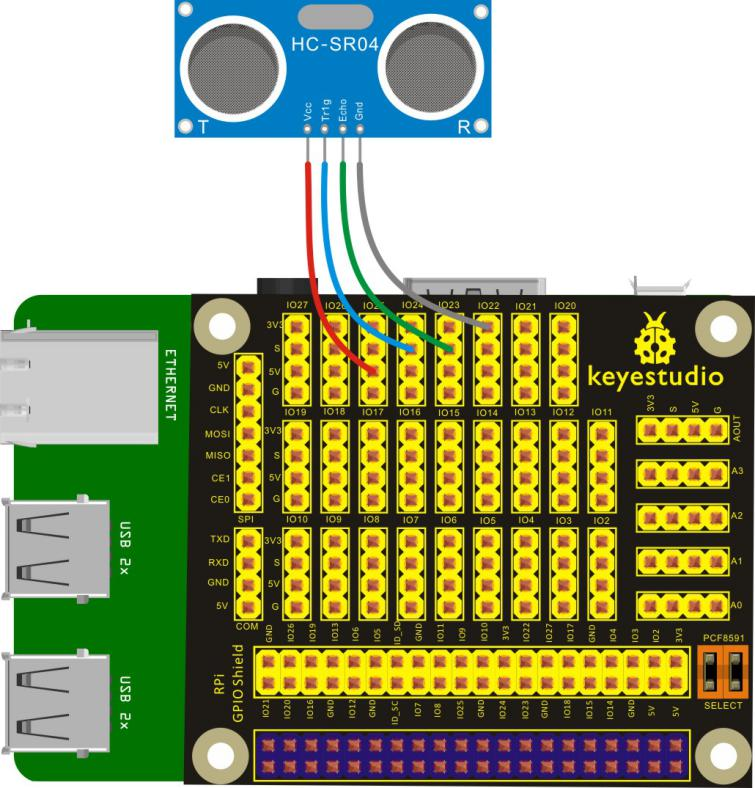
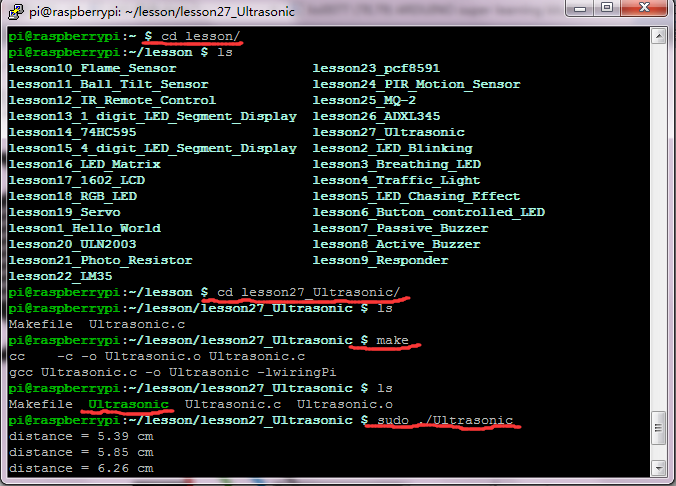

## Lesson 27: Ultrasonic Sensor

1.  Introduction

In the lesson, HC-SR04 Ultrasonic Sensor is connected to Keyestudio     RPI GPIO-PCF8591 Shield, you can see the distance value of     ultrasonic detection on the terminal.

2.  Hardware Required

HC-SR04 Ultrasonic Sensor\*1

Keyestudio RPI GPIO-PCF8591 Shield\*1

USB Cable \* 1

   Raspberry Motherboard \* 1

Dupont Wires\* several

3.  Connection Diagram

4.  Programming

1.  Use winSCP to put the lesson27_Ultrasonic into the lesson folder     of raspberry system.

2.  In the terminal, input cd lesson27_Ultrasonic to enter the     folder.

3.  In the terminal, execute make to generate Ultrasonic
executable file inside the folder.

4.  Wiring as the above diagram, then enter the lesson27_Ultrasonic     folder, execute sudo ./Ultrasonic at the terminal. Then, you can     see the distance value detected by ultrasonic sensor on the     terminal.

5.  Ctrl + c can exit the processing program.

5.  Source Code

////////////////////////////////////////////////////////////////////////////////////////////////////////////////////////

\#include \<wiringPi.h\>

\#include \<stdio.h\>

\#include \<sys/time.h\>

\#define Trig 5

\#define Echo 4

void ultraInit(void)

{

pinMode(Echo, INPUT);

pinMode(Trig, OUTPUT);

}

float disMeasure(void)

{

struct timeval tv1;

struct timeval tv2;

long start, stop;

float dis;

digitalWrite(Trig, LOW);

delayMicroseconds(2);

digitalWrite(Trig, HIGH);

delayMicroseconds(10);

digitalWrite(Trig, LOW);

while(!(digitalRead(Echo) == 1));

gettimeofday(&tv1, NULL);

while(!(digitalRead(Echo) == 0));

gettimeofday(&tv2, NULL);

start = tv1.tv_sec \* 1000000 + tv1.tv_usec;

stop = tv2.tv_sec \* 1000000 + tv2.tv_usec;

dis = (float)(stop - start) / 1000000 \* 34000 / 2;

return dis;

}

int main(void)

{

float dis;

if(wiringPiSetup() == -1){ //when initialize wiring failed,print messageto screen

printf("setup wiringPi failed !");

return 1;

}

ultraInit();

while(1){

dis = disMeasure();

printf("distance = %0.2f cm\n",dis);

delay(500);

}

return 0;

}

////////////////////////////////////////////////////////////////////////////////////////////////////////////////////////

