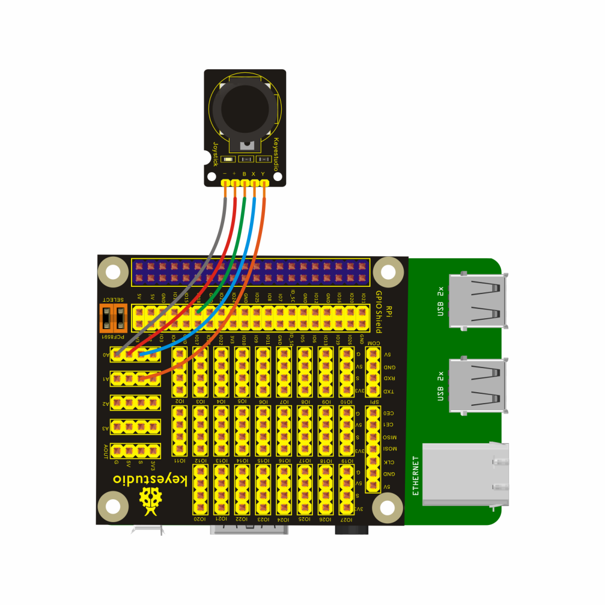
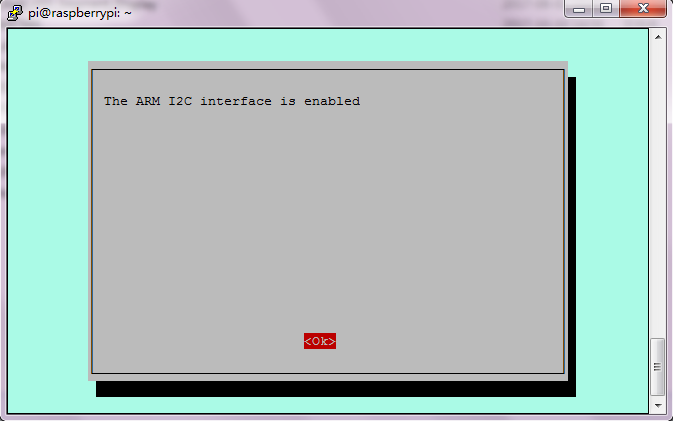
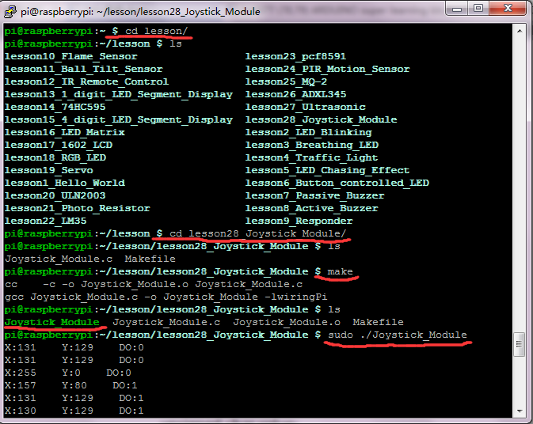

## Lesson 28: Joystick Module

1.  Introduction

Joystick Module is made of original premium metal PS2 rocker     potentiometer with (X, Y) 2-axis analog output, (Z) 1-way button     digital output.

In the previous lesson, we have connected the 10KΩpotentiometer to     the Keyestudio RPI GPIO-PCF8591 Shield to test the     raspberry-extended AD function. In this course, we will connect     Joystick Module to the Keyestudio RPI GPIO-PCF8591 Shield, after     running the program, you can see the input value of Joystick Module     x, y-dimension, and the output value of z-dimension on the terminal.

2.  Hardware Required

Joystick Module\*1

Keyestudio RPI GPIO-PCF8591 Shield

USB Cable \* 1

   Raspberry Motherboard \* 1

Dupont Wires\* several

3.  Connection Diagram

4.  Programming

1.  Raspberry pi default not open the I2C function, on the terminal,     input sudo raspi-config to open raspberry configuration     interface.

2.  Select the 7 Advanced Options, then select the A7 I2C option to     enable the raspberry pi I2C function.

3.  Use winSCP to put the lesson28_Joystick_Module into the lesson     folder of raspberry system.

4.  In the terminal, input cd lesson and cd     lesson28_Joystick_Module to enter the folder.

5.  In the terminal, execute make to generate a Joystick_Module
executable file inside the folder.

6.  Wiring as the above diagram, enter thelesson28_Joystick_Module     folder, then execute sudo ./Joystick_Module at the terminal.     Then, you can see the input value of Joystick Module x, y-dimension,     and the output value of z-dimension on the terminal.

7.  Ctrl + c can exit the processing program.

Please refer to the figure below:

5.  Source Code

////////////////////////////////////////////////////////////////////////////////////////////////////////////////////////

\#include \<wiringPi.h\>

\#include \<pcf8591.h\>

\#include \<stdio.h\>

\#define Address 0x48

\#define BASE 64

\#define A0 BASE+0

\#define A1 BASE+1

\#define A2 BASE+2

\#define A3 BASE+3

char dat;

int main(void)

{

unsigned char value;

wiringPiSetup();

pinMode(1,INPUT);

pcf8591Setup(BASE,Address);

while(1)

{

value=analogRead(A0);

printf("X:%d ",value);

value=analogRead(A1);

printf("Y:%d ",value);

dat=digitalRead(1);

if(dat==HIGH)

printf("DO:%d\n",dat);

if(dat==LOW)

printf("DO:%d\n",dat);

delay(100);

// analogWrite(BASE,value++);

// printf("AOUT:%d\n",value++);

// delay(50);

}

}

////////////////////////////////////////////////////////////////////////////////////////////////////////////////////////

