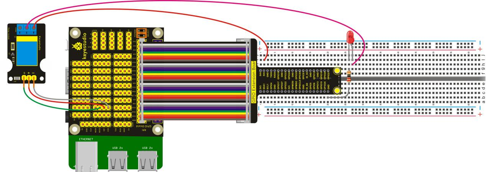
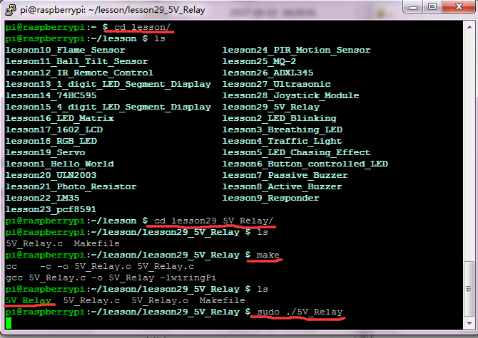

## Lesson 29: 5V Relay

1.  Introduction

In this lesson, we just simply test the 5V relay. The relay is     available for high level, when the signal end inputs high level, the     "ON" side is closed, LED lights up; otherwise it will be     disconnected, LED off. In the experiment, we just make the relay     closed for 0.5S, then disconnected for 0.5S, repeatedly cycle.

2.  Hardware Required

   Relay Module\*1

LED - Red \*1

220Ω Resistor\*1

RPI GPIO Shield\*1

40 pin Colorful Jumper Wires\*1

Keyestudio RPI GPIO-PCF8591 Shield\*1

Breadboard\*1

USB Cable \* 1

   Raspberry Motherboard \* 1

Dupont Wires\* several

Jumper Wires\* several

3.  Connection Diagram

4.  Programming

1.  Use winSCP to put the lesson29_5V_Relay into the lesson folder     of raspberry system.

2.  In the terminal, input cd lesson29_5V_Relay to enter the folder.

3.  In the terminal, execute make to generate a 5V_Relay
executable file inside the folder.

4.  Wiring as the above diagram, then enter the lesson29_5V_Relay     folder, execute sudo ./5V_Relay at the terminal. It can achieve     the effect of blinking LED.

5.  Ctrl + c can exit the processing program.

5.  Source Code

////////////////////////////////////////////////////////////////////////////////////////////////////////////////////////

\#include \<wiringPi.h\>

int main()

{

wiringPiSetup();

{

pinMode(1,OUTPUT);

}

while(1)

{

digitalWrite(1,HIGH);

delay(500);

digitalWrite(1,LOW);

delay(500);

}

}

////////////////////////////////////////////////////////////////////////////////////////////////////////////////////////

