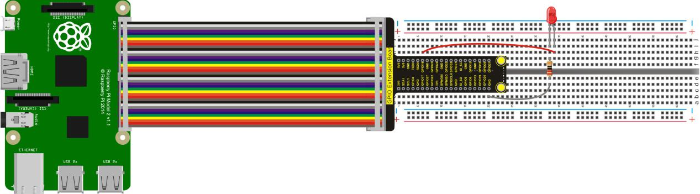
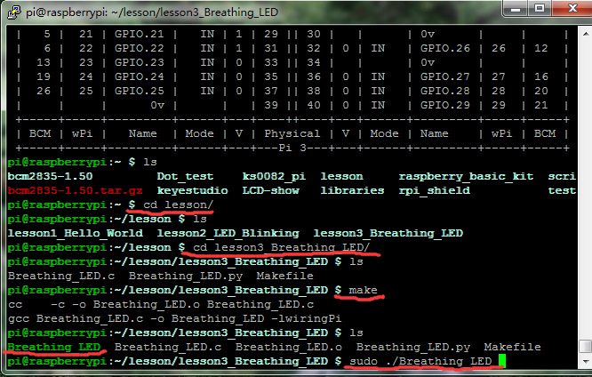
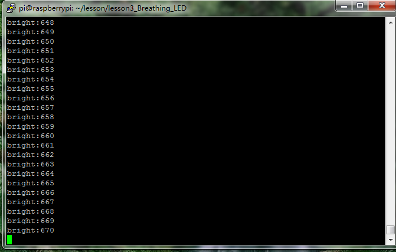

## Lesson 3: Breathing LED

1.  Introduction

In the last lesson, we have controlled the LED light’s on and off by     controlling the I/O port of Raspberry Pi to output high and low     levels. This time we come to control LED light’s brightness, and     finally make the effect of breathing light.

2.  Hardware Required

Red LED \*1

220Ω Resistor\*1

RPI GPIO Shield\*1

40 Pin Colorful Jumper Wires\*1

Breadboard\*1

USB Cable\*1

Raspberry Motherboard\*1

Jumper Wires\*Several


3.  Connection Diagram



4.  Programming

1.  Use winSCP to put the lesson3_Breathing_LED into the lesson     folder of raspberry system.

2.  In the terminal input cd lesson3_Breathing_LED to enter the     folder.

3.  In the terminal execute make to generate a Breathing_LED
executable file inside the folder.

4.  Wiring as the above diagram, then enter the lesson3_Breathing_LED     folder, execute sudo ./Breathing_LED at the terminal. It can     achieve the effect of breathing light, and display the corresponding     data in the terminal.

5.  Ctrl + c can exit the processing program.





5.  Sample Code

```c
 #include <stdio.h>
 #include <stdlib.h>
 #include <stdint.h>
 #include <wiringPi.h>
 
 #define LED 1

int main(void)
{
   int bright;
    printf("Raspberry Pi wiringPi PWM test program\n");
    if (wiringPiSetup() == -1)
     {
        printf("GPIO setup error!\n");
         exit(1);
    }
    pinMode(LED,PWM_OUTPUT);
     while(1)
    {
     for (bright = 0; bright < 1024; ++bright)
         {
            pwmWrite(LED,bright);
            printf("bright:%d\n",bright);
             delay(3);
        }
    for (bright = 1023; bright >= 0; --bright)
        {
             pwmWrite(LED,bright);
             printf("bright:%d\n",bright);
             delay(3);
         }
       }
     return 0;
 }
```

