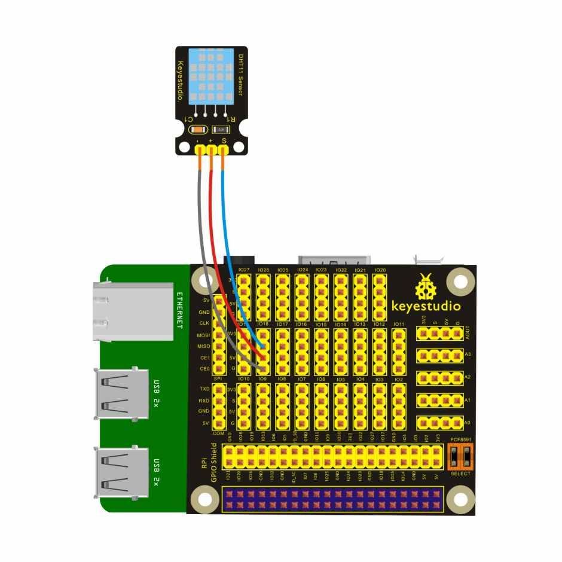
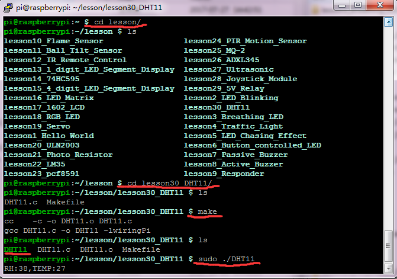

## Lesson 30: DHT11 Temp and Humidity Sensor

1.  Introduction

This lesson will directly connect DHT11 Temperature and Humidity     Sensor to Keyestudio RPI GPIO-PCF8591 Shield to test the temperature     and humidity of current environment, and you can see the     corresponding value on the terminal of raspberry pi.

2.  Hardware Required

DHT11 Temperature and Humidity Sensor\*1

Keyestudio RPI GPIO-PCF8591 Shield\*1

USB Cable \* 1

   Raspberry Motherboard \* 1

Dupont Wires\* several

3.  Connection Diagram

4.  Programming

1.  Use winSCP to put the lesson30_DHT11 into the lesson folder of     raspberry system.

2.  In the terminal, input cd lesson30_DHT11 to enter the folder.

3.  In the terminal, execute make to generate DHT11 executable     file inside the folder.

4.  Wiring as the above diagram, then enter the lesson30_DHT11 folder,     execute sudo ./DHT11 at the terminal. Then, you can see the     corresponding temperature and humidity value of current environment     on the terminal.

5.  Ctrl + c can exit the processing program.

5.  Source Code

////////////////////////////////////////////////////////////////////////////////////////////////////////////////////////

\#include \<wiringPi.h\>

\#include \<stdio.h\>

\#include \<stdlib.h\>

\#include \<stdint.h\>

\#define MAX_TIME 85

\#define DHT11PIN 1

\#define ATTEMPTS 5 //retry 5 times when no response

int dht11_val\[5\]={0,0,0,0,0};

int dht11_read_val(){

uint8_t lststate=HIGH; //last state

uint8_t counter=0;

uint8_t j=0,i;

for(i=0;i\<5;i++)

dht11_val\[i\]=0;

//host send start signal

pinMode(DHT11PIN,OUTPUT); //set pin to output

digitalWrite(DHT11PIN,LOW); //set to low at least 18ms

delay(18);

digitalWrite(DHT11PIN,HIGH); //set to high 20-40us

delayMicroseconds(40);

//start recieve dht response

pinMode(DHT11PIN,INPUT); //set pin to input

for(i=0;i\<MAX_TIME;i++)

{

counter=0;

while(digitalRead(DHT11PIN)==lststate){ //read pin state to see if dht responsed. if dht always high for 255 + 1 times, break this while circle

counter++;

delayMicroseconds(1);

if(counter==255)

break;

}

lststate=digitalRead(DHT11PIN); //read current state and store as last state.

if(counter==255) //if dht always high for 255 + 1 times, break this for circle

break;

// top 3 transistions are ignored, maybe aim to wait for dht finish response signal

if((i\>=4)&&(i%2==0)){

dht11_val\[j/8\]\<\<=1; //write 1 bit to 0 by moving left (auto add 0)

if(counter\>16) //long mean 1

dht11_val\[j/8\]|=1; //write 1 bit to 1

j++;

}

}

// verify checksum and print the verified data

if((j\>=40)&&(dht11_val\[4\]==((dht11_val\[0\]+dht11_val\[1\]+dht11_val\[2\]+dht11_val\[3\])&
0xFF))){

printf("RH:%d,TEMP:%d\n",dht11_val\[0\],dht11_val\[2\]);

return 1;

}

else

return 0;

}

int main(void){

int attempts=ATTEMPTS;

if(wiringPiSetup()==-1)

exit(1);

while(attempts){ //you have 5 times to retry

int success = dht11_read_val(); //get result including printing out

if (success) { //if get result, quit program; if not, retry 5 times then quit

break;

}

attempts--;

delay(2500);

}

return 0;

}

////////////////////////////////////////////////////////////////////////////////////////////////////////////////////////

