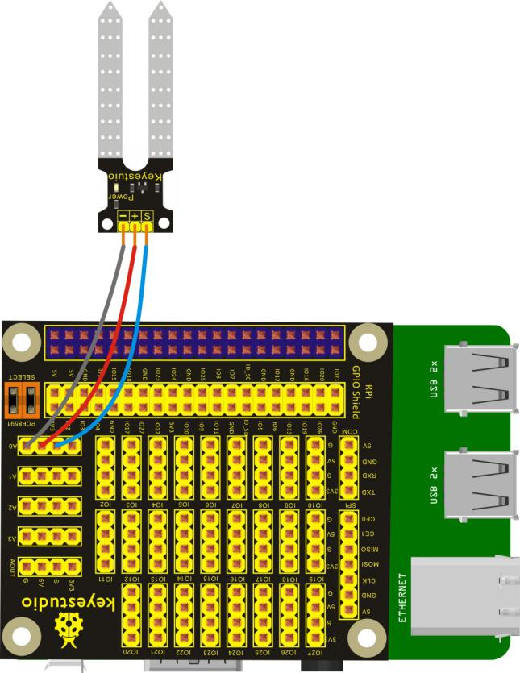
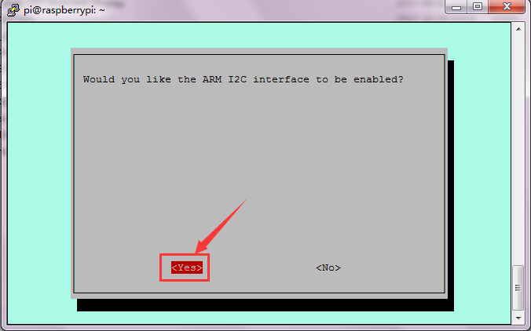
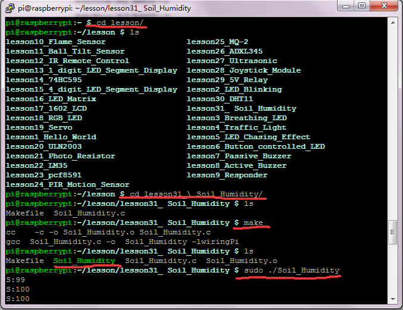

## Lesson 31: Soil Humidity Sensor

1.  Introduction

In the previous lesson, we have connected a soil humidity sensor to     keyestudio RPI GPIO-PCF8591 Shield to test extended AD function of     raspberry pi. This lesson we will directly connect an external soil     humidity sensor to test the humidity of soil, and you can see the     corresponding value on the terminal of raspberry pi.

2.  Hardware Required

Soil Humidity Sensor\*1

Keyestudio RPI GPIO-PCF8591 Shield\*1

USB Cable \* 1

   Raspberry Motherboard \* 1

Dupont Wires\* several

3.  Connection Diagram

4.  Programming

1.  Raspberry pi default not open the I2C function, on the terminal,     input sudo raspi-config to open raspberry configuration     interface.

2.  Select the 7 Advanced Options, then select the A7 I2C option to     enable the raspberry pi I2C function.

3.  Use winSCP to put the lesson31\_ Soil_Humidity into the lesson     folder of raspberry system.

4.  In the terminal, input cd lesson and cd lesson31\_
Soil_Humidity to enter the folder.

5.  In the terminal, execute make to generate Soil_Humidity
executable file inside the folder.

6.  Wiring as the above diagram, then enter the lesson31\_ Soil_Humidity     folder, execute sudo ./Soil_Humidity at the terminal. Then, you     can see the value of soil humidity（0-255） on the terminal.

7.  Ctrl + c can exit the processing program.

Please refer to the figure below:

5.  Source Code

////////////////////////////////////////////////////////////////////////////////////////////////////////////////////////

\#include \<wiringPi.h\>

\#include \<pcf8591.h\>

\#include \<stdio.h\>

\#define Address 0x48

\#define BASE 64

\#define A0 BASE+0

\#define A1 BASE+1

\#define A2 BASE+2

\#define A3 BASE+3

int main(void)

{

unsigned char value;

wiringPiSetup();

pcf8591Setup(BASE,Address);

while(1)

{

value=analogRead(A0);

printf("S:%d\n",value);

delay(50);

}

}

////////////////////////////////////////////////////////////////////////////////////////////////////////////////////////

