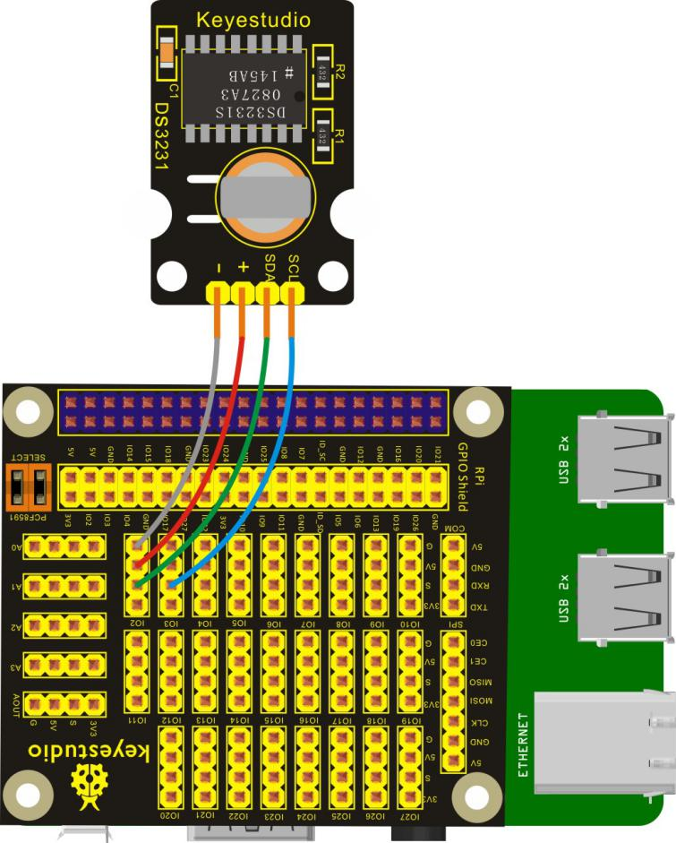
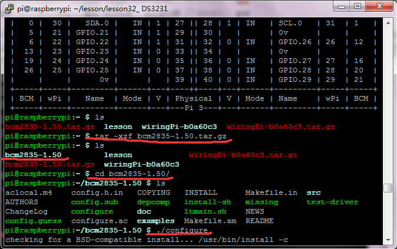
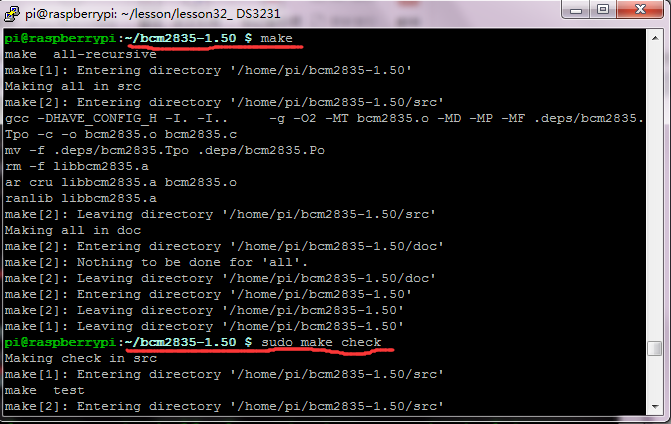
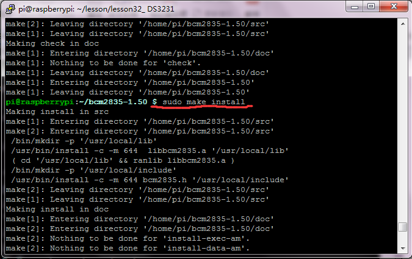
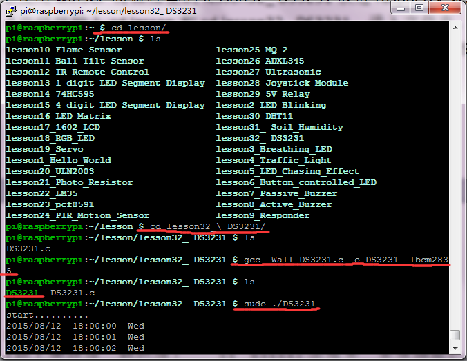

## Lesson 32: DS3231 Clock Module

1.  Introduction

This lesson will mainly use DS3231 Clock Module. In the lesson, you     can see the setting time regarded as the starting time to start     accurate timing on the terminal .

2.  Hardware Required

DS3231 Clock Module\*1

Keyestudio RPI GPIO-PCF8591 Shield\*1

USB Cable \* 1

   Raspberry Motherboard \* 1

Dupont Wires\* several

3.  Connection Diagram

4.  Programming

1.  This lesson will use the bcm2835 library function, and we have     provided you with the installation package. First put winSCP     compressed files into the system, and then input tar-xzf     bcm2835-1.50.tar.gz on the terminal to extract the file.

2.  On the terminal, input cd bcm2835-1.50 to enter inside the     bcm2835-1.50 folder, then execute:

./configure

make

sudo make check

sudo make install

Installation finished

3.  Use winSCP to put the lesson32\_ DS3231 into the lesson folder     of raspberry system.

4.  In the terminal, input cd lesson and cd lesson32\_ DS3231 to     enter the folder.

5.  In the terminal, input gcc –Wall DS3231.c –o DS3231 –lbcm2835,     to generate DS3231 executable file inside the folder.

6.  Wiring as the above diagram, then enter the lesson32\_ DS3231     folder, execute sudo ./DS3231 at the terminal. Then, you can see     the setting time regarded as the starting time to start accurate     timing on the terminal.

7.  Ctrl + c can exit the processing program.

Please refer to the figure below:

5.  Source Code

////////////////////////////////////////////////////////////////////////////////////////////////////////////////////////

\#include \<bcm2835.h\>

\#include \<stdio.h\>

\#include \<unistd.h\>

//regaddr,seconds,minutes,hours,weekdays,days,months,yeas

char buf\[\]={0x00,0x00,0x00,0x18,0x04,0x12,0x08,0x15};

char \*str\[\] ={"SUN","Mon","Tues","Wed","Thur","Fri","Sat"};

void pcf8563SetTime()

{

bcm2835_i2c_write(buf,8);

}

void pcf8563ReadTime()

{

buf\[0\] = 0x00;

bcm2835_i2c_write_read_rs(buf ,1, buf,7);

}

int main(int argc, char \*\*argv)

{

if (!bcm2835_init())return 1;

bcm2835_i2c_begin();

bcm2835_i2c_setSlaveAddress(0x68);

bcm2835_i2c_set_baudrate(10000);

printf("start..........\n");

pcf8563SetTime();

while(1)

{

pcf8563ReadTime();

buf\[0\] = buf\[0\]&0x7F; //sec

buf\[1\] = buf\[1\]&0x7F; //min

buf\[2\] = buf\[2\]&0x3F; //hour

buf\[3\] = buf\[3\]&0x07; //week

buf\[4\] = buf\[4\]&0x3F; //day

buf\[5\] = buf\[5\]&0x1F; //mouth

//year/month/day

printf("20%02x/%02x/%02x ",buf\[6\],buf\[5\],buf\[4\]);

//hour:minute/second

printf("%02x:%02x:%02x ",buf\[2\],buf\[1\],buf\[0\]);

//weekday

printf("%s\n",str\[(unsigned char)buf\[3\]-1\]);

bcm2835_delay(1000);

}

bcm2835_i2c_end();

bcm2835_close();

return 0;

}

////////////////////////////////////////////////////////////////////////////////////////////////////////////////////////

