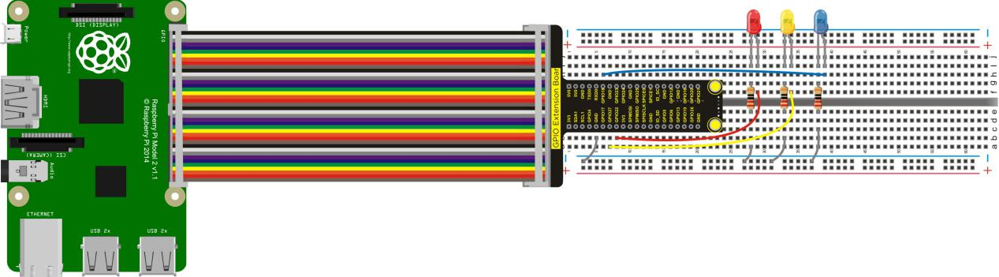
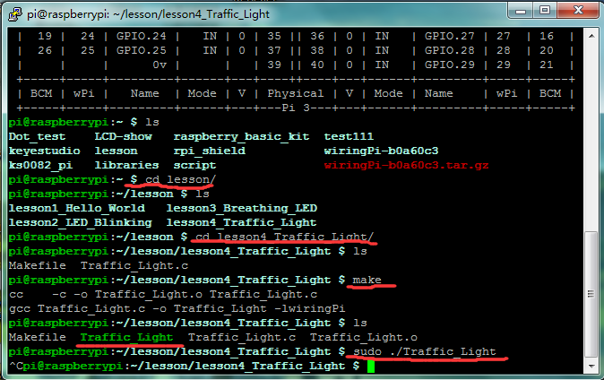

## Lesson 4: Traffic Light

1.  Introduction

This lesson is expanded on the basis of lesson 2. We are going to     control three LED lights’ on and off by controlling three I/O ports     of Raspberry Pi, so as to simulate the traffic light phenomenon.

2.  Hardware Required

LED - Red \*1

LED - Blue\*1

LED - Yellow\*1

220Ω Resistor\*3

RPI GPIO Shield\*1

Breadboard\*1

40 Pin Colorful Jumper Wires\*1

USB Cable\*1

Raspberry Motherboard\*1

Jumper Wires\*Several

3.  Connection Diagram

4.  Programming

1.  Use winSCP to put the lesson4_Traffic_Light into the lesson     folder of raspberry system.

2.  In the terminal input cd lesson4_Traffic_Light to enter the     folder.

3.  In the terminal execute make to generate a Traffic_Light
executable file inside the folder.

4.  Wiring as the above diagram, then enter the lesson4_Traffic_Light     folder, execute sudo ./Traffic_Light at the terminal. It can     achieve the effect of traffic light.

5.  Ctrl + c can exit the processing program.

5.  Sample Code

////////////////////////////////////////////////////////////////////////////////////////////////////////////////////////

\#include \<wiringPi.h\>

int main()

{

wiringPiSetup();

char i;

char j;

for(i=1;i\<4;i++)

{

pinMode(i,OUTPUT);

}

while(1)

{

digitalWrite(1, HIGH);//// turn on blue LED

delay(5000);// wait 5 seconds

digitalWrite(1, LOW); // turn off blue LED

for(j=0;j\<3;j++) // blinks for 3 times

{

delay(500);// wait 0.5 second

digitalWrite(2, HIGH);// turn on yellow LED

delay(500);// wait 0.5 second

digitalWrite(2, LOW);// turn off yellow LED

}

delay(500);// wait 0.5 second

digitalWrite(3, HIGH);// turn on red LED

delay(5000);// wait 5 second

digitalWrite(3, LOW);// turn off red LED

}

}

////////////////////////////////////////////////////////////////////////////////////////////////////////////////////////

