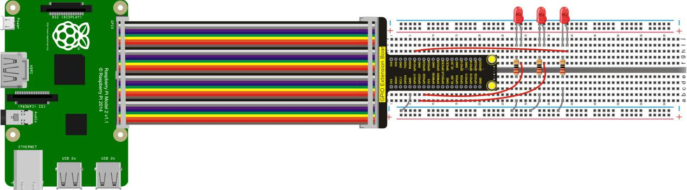
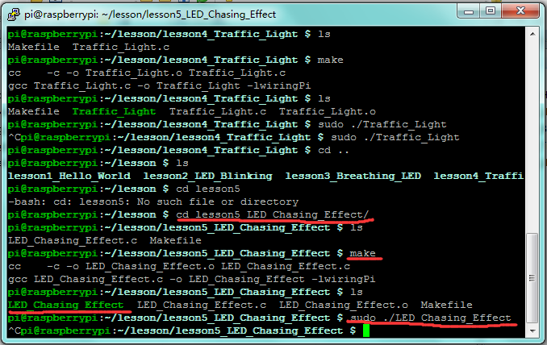

## Lesson 5: LED Chasing Effect

1.  Introduction

This lesson is expanded on the basis of lesson 2. We are going to     control three LED lights’ on and off by controlling three I/O ports     of Raspberry Pi, so as to achieve the flowing water light     phenomenon.

2.  Hardware Required

Red LED \*3

220Ω Resistor\*3

RPI GPIO Shield\*1

Breadboard\*1

40 Pin Colorful Jumper Wires\*1

USB Cable\*1

Raspberry Motherboard\*1

Jumper Wires\*Several

3.  Connection Diagram

4. Programming

1.  Use winSCP to put the lesson5_LED_Chasing_Effect into the lesson     folder of raspberry system.

2.  In the terminal input cd lesson5_LED_Chasing_Effect to enter the     folder.

3.  In the terminal execute make to generate an     LED_Chasing_Effect executable file inside the folder.

4.  Wiring as the above diagram, then enter the     lesson5_LED_Chasing_Effect folder, execute sudo     ./LED_Chasing_Effect at the terminal. It can achieve the effect of     flowing water light.

5.  Ctrl + c can exit the processing program.

5.  Sample Code

////////////////////////////////////////////////////////////////////////////////////////////////////////////////////////

\#include \<wiringPi.h\>

int main()

{

wiringPiSetup();

char i;

for(i=1;i\<4;i++)

{

pinMode(i,OUTPUT);

}

while(1)

{

for (i=1;i\<4;i ++)

{

digitalWrite(i, LOW);// set I/O pins as “low”

delay(200); // delay

}

for (i=1;i\<4;i ++)

{

digitalWrite(i, HIGH);// set I/O pins as “high”

delay(200); // delay

}

}

}

////////////////////////////////////////////////////////////////////////////////////////////////////////////////////////

