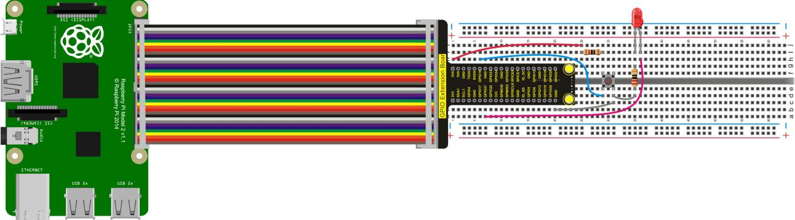
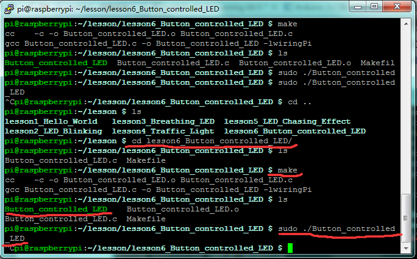

## Lesson 6: Button-controlled LED

1.  Introduction

I/O port means the INPUT interface and OUTPUT interface. In the     above courses we only used the output function of Raspberry Pi I/O     port, so this time we will use its I/O port input function. In this     lesson, we use a button component to control the LED’s on and off.

2.  Hardware Required

Red LED\*1

220Ω Resistor\*1

Large Button Switch \*1

10KΩ Resistor\*1

RPI GPIO Shield\*1

40 Pin Colorful Jumper Wires\*1

Breadboard\*1

USB Cable\*1

Raspberry Motherboard\*1

Jumper Wires\*Several

3.  Connection Diagram

4.  Programming

1.  Use winSCP to put the lesson6_Button_controlled_LED into the     lesson folder of raspberry system.

2.  In the terminal input cd lesson6_Button_controlled_LED to enter     the folder.

3.  In the terminal execute make to generate a     Button_controlled_LED executable file inside the folder.

4.  Wiring as the above diagram, then enter the     lesson6_Button_controlled_LED folder, execute sudo     ./Button_controlled_LED at the terminal. It can achieve the effect     of button controlled LED.

5.  Ctrl + c can exit the processing program.

5.  Sample Code

////////////////////////////////////////////////////////////////////////////////////////////////////////////////////////

\#include \<wiringPi.h\>

int main()

{

wiringPiSetup();

char val;

{

pinMode(1,INPUT);

pinMode(2,OUTPUT);

}

while(1)

{

val=digitalRead(1);

if(val==1)//check if the button is pressed, if yes, turn on the LED

digitalWrite(2,LOW);

else

digitalWrite(2,HIGH);

}

}

////////////////////////////////////////////////////////////////////////////////////////////////////////////////////////

