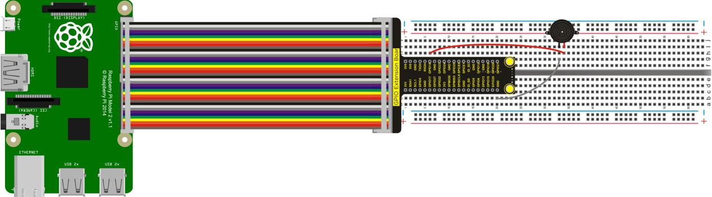
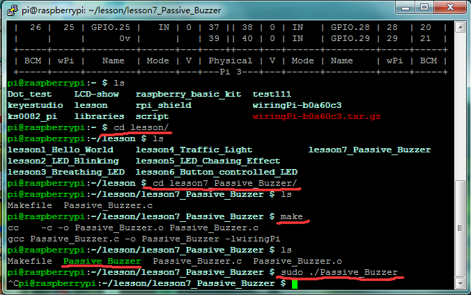

## Lesson 7: Passive Buzzer

1.  Introduction

Using Raspberry Pi can finish many interactive works. The most     common seen and used is the sound and light show. We have used LED     in the previous experiment, so this experiment will let the circuit     make sound. We will use the passive buzzer and its ideal working     signal is square wave. In the experiment, using Raspberry Pi’s I/O     port outputs high and low levels to simulate square wave, thus     controlling the passive buzzer ringing.

2.  Hardware Required

Passive Buzzer\*1

RPI GPIO Shield\*1

40 Pin Colorful Jumper Wires\*1

Breadboard\*1

USB Cable\*1

Raspberry Motherboard\*1

Jumper Wires\*Several

3.  Connection Diagram

4.  Programming

1.  Use winSCP to put the lesson7_Passive_Buzzer into the lesson     folder of raspberry system.

2.  In the terminal input cd lesson7_Passive_Buzzer to enter the     folder.

3.  In the terminal execute make to generate a Passive_Buzzer
executable file inside the folder.

4.  Wiring as the above diagram, then enter the lesson7_Passive_Buzzer     folder, execute sudo ./Passive_Buzzer at the terminal. It can     achieve the effect of passive buzzer ringing.

5.  Ctrl + c can exit the processing program.

5.  Sample Code

////////////////////////////////////////////////////////////////////////////////////////////////////////////////////////

\#include \<wiringPi.h\>

int main()

{

wiringPiSetup();

char i;

char j;

{

pinMode(1,OUTPUT);

}

while(1)

{

for(i=0;i\<80;i++)// output a frequency sound

{ digitalWrite(1,HIGH);// sound

delay(1);//delay1ms

digitalWrite(1,LOW);//not sound

delay(1);//ms delay

}

for(j=0;j\<100;j++)// output a frequency sound

{ digitalWrite(1,HIGH);// sound

delay(2);

digitalWrite(1,LOW);//not sound

delay(2);//2ms delay

}

}

}

////////////////////////////////////////////////////////////////////////////////////////////////////////////////////////

