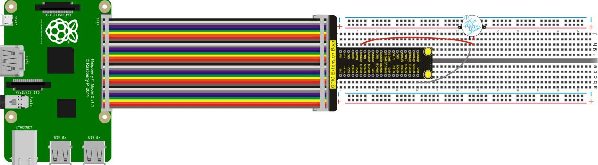
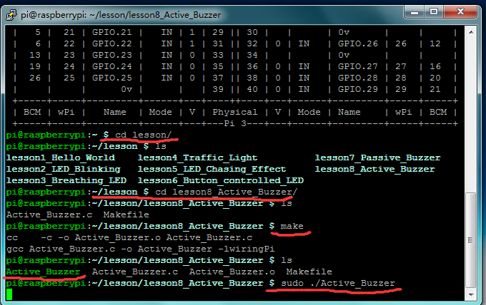

## Lesson 8: Active Buzzer

1.  Introduction

In the last lesson, we have finished a passive buzzer ringing     experiment. This time, we will make an active buzzer sound test.     Relative to the passive buzzer, active buzzer can automatically make     sounds only inputting a high level because it has an own oscillator     source. In the experiment, we simply let the buzzer ring for one     second and stop for one second, repeating alternately.

2.  Hardware Required

Active Buzzer \*1

RPI GPIO Shield\*1

40 Pin Colorful Jumper Wires\*1

Breadboard\*1

USB Cable\*1

Raspberry Motherboard\*1

Jumper Wires\*Several

3.  Connection Diagram

4.  Programming

1.  Use winSCP to put the lesson8_Active_Buzzer into the lesson     folder of raspberry system.

2.  In the terminal input cd lesson8_Active_Buzzer to enter the     folder.

3.  In the terminal execute make to generate an Active_Buzzer
executable file inside the folder.

4.  Wiring as the above diagram, then enter the lesson8_Active_Buzzer     folder, execute sudo ./Active_Buzzer at the terminal. The active     buzzer rings for one second and stops for one second, repeating     alternately.

5.  Ctrl + c can exit the processing program.

5.  Sample Code

////////////////////////////////////////////////////////////////////////////////////////////////////////////////////////

\#include \<wiringPi.h\>

int main()

{

wiringPiSetup();

{

pinMode(1,OUTPUT);

}

while(1)

{

digitalWrite(1,HIGH);

delay(1000);

digitalWrite(1,LOW);

delay(1000);

}

}

////////////////////////////////////////////////////////////////////////////////////////////////////////////////////////

