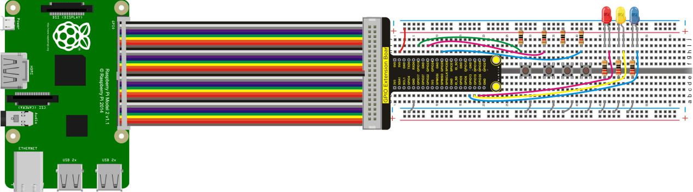
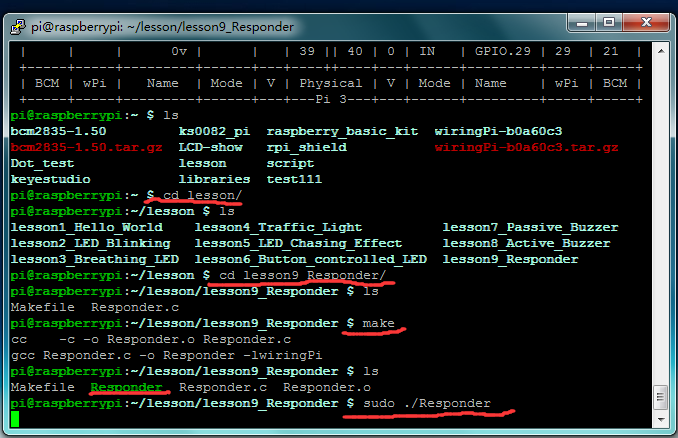

## Lesson 9: Responder

1.  Introduction

In this experiment, we make a further learning on the basis of     lesson 6. We use four buttons to control three LEDs, making a     responder.

2.  Hardware Required

LED - Red \*1

LED - Blue\*1

LED - Yellow\*1

220Ω Resistor\*3

Large Button Switch \*4

10KΩ Resistor\*4

RPI GPIO Shield\*1

40 Pin Colorful Jumper Wire\*1

Breadboard\*1

USB Cable\*1

Raspberry Motherboard\*1

Jumper Wires\*Several

3.  Connection Diagram

4.  Programming

1.  Use winSCP to put the lesson9_Responder into the lesson folder     of raspberry system.

2.  In the terminal input cd lesson9_Responder to enter the folder.

3.  In the terminal execute make to generate a Responder
executable file inside the folder.

4.  Wiring as the above diagram, then enter the lesson9_Responder     folder, execute sudo ./Responder at the terminal. Press the     corresponding button to control the LED, so it is equivalent to a     responder.

5.  Ctrl + c can exit the processing program.

5.  Sample Code

////////////////////////////////////////////////////////////////////////////////////////////////////////////////////////

\#include \<wiringPi.h\>

int redled=25; // set red LED as “output”

int yellowled=24; // set yellow LED as “output”

int blueled=23; // set blue LED as “output”

int redpin=4; // initialize pin for red button

int yellowpin=5; // initialize pin for yellow button

int bluepin=6; // initialize pin for blue button

int restpin=1; // initialize pin for reset button

int red;

int yellow;

int blue;

void clear_led()// all LED off

{

digitalWrite(redled,LOW);

digitalWrite(blueled,LOW);

digitalWrite(yellowled,LOW);

}

void RED_YES()// execute the code until red light is on; end cycle when reset button is pressed

{

while(digitalRead(restpin)==1)

{

digitalWrite(redled,HIGH);

digitalWrite(blueled,LOW);

digitalWrite(yellowled,LOW);

}

clear_led();

}

void YELLOW_YES()// execute the code until yellow light is on; end cycle when reset button is pressed

{

while(digitalRead(restpin)==1)

{

digitalWrite(redled,LOW);

digitalWrite(blueled,LOW);

digitalWrite(yellowled,HIGH);

}

clear_led();

}

void BLUE_YES()// execute the code until green light is on; end cycle when reset button is pressed

{

while(digitalRead(restpin)==1)

{

digitalWrite(redled,LOW);

digitalWrite(blueled,HIGH);

digitalWrite(yellowled,LOW);

}

clear_led();

}

int main()

{

wiringPiSetup();

{

pinMode(redled,OUTPUT);

pinMode(yellowled,OUTPUT);

pinMode(blueled,OUTPUT);

pinMode(redpin,INPUT);

pinMode(yellowpin,INPUT);

pinMode(bluepin,INPUT);

}

while(1)

{

red=digitalRead(redpin);

yellow=digitalRead(yellowpin);

blue=digitalRead(bluepin);

if(red==LOW)RED_YES();

if(yellow==LOW)YELLOW_YES();

if(blue==LOW)BLUE_YES();

}

}

////////////////////////////////////////////////////////////////////////////////////////////////////////////////////////

